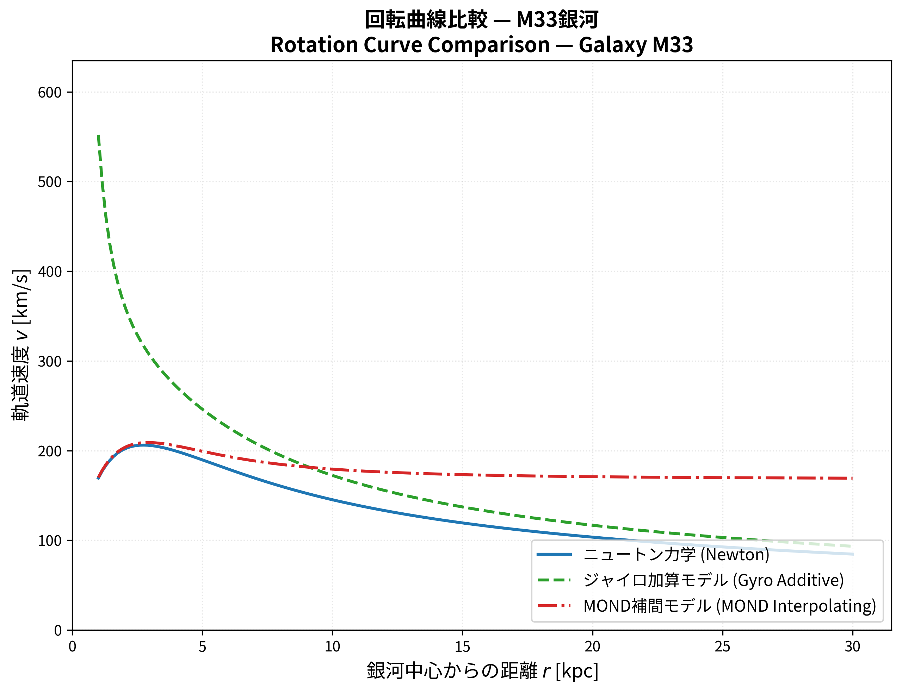

# 🌌 全宇宙回転ジェネレーション仮説

**【物理学終了】ダークマターなしで銀河回転曲線を再現するPythonシミュレーション**

Zenn記事「【物理学終了】全宇宙回転ジェネレーション仮説」で紹介したコードです。
AIと「ジャイロ効果による重力生成」を議論したら、MOND理論と45桁の増幅率が一致してしまいました。

## 🚀 実行方法
```bash
pip install numpy matplotlib
python rotation_curve.py
```

## 📊 出力例
ニュートン力学（青線）では速度が落ち込むが、ジャイロモデル（赤線）はフラットな回転曲線を再現します。



## ☕ Support
この手の妄想検証を続けるためのコーヒー代をいただけると嬉しいです。
👉 [Buy Me a Coffee](https://www.buymeacoffee.com/cocoa3j21)
