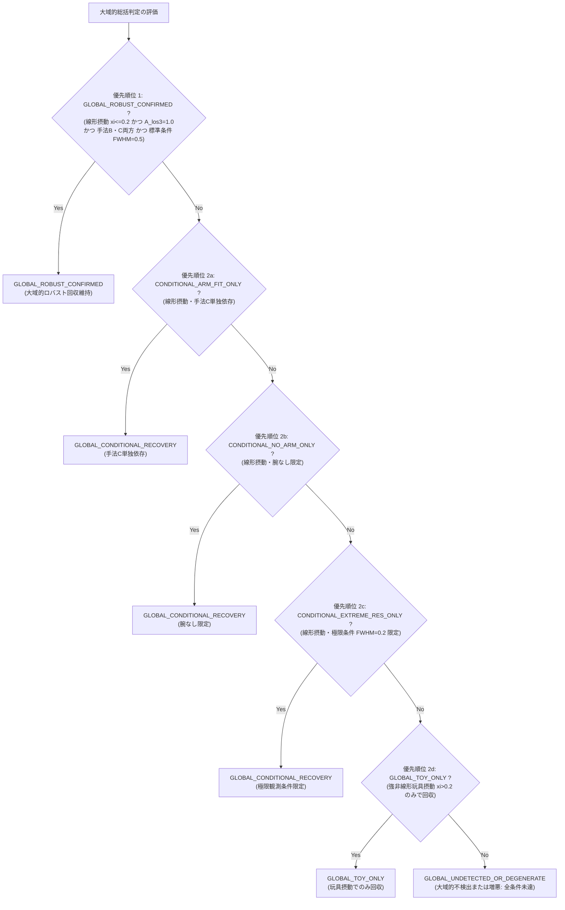
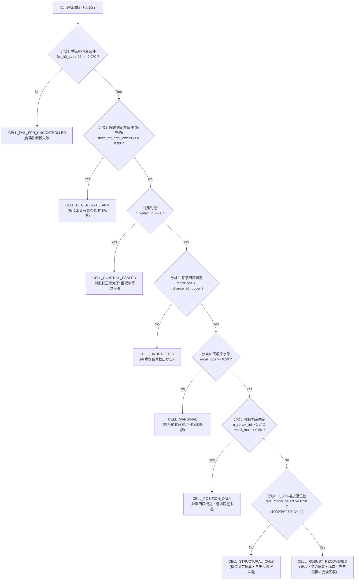

# 少数量子渦の2次元視線速度残差マップ 注入・回収試験設計書（第7版・確定仕様）
**Rigorous Specification for Injection-Recovery Testing of Local Superfluid Vortex Signatures (v7 Final)**

- **対象プロジェクト**: `universal-rotation-hypothesis`（宇宙論・物理学・数理検証のみ）
- **文書ステータス**: 実装前設計仕様書（第7版・改訂確定版・陽性対照および幾何照合是正版）
- **前提事項**: コード実装、観測データ使用、公開、コミット、pushは一切行わない。
- **不偏性の基本姿勢**: 本試験は仮説の「成功」を前提としない。全配置・全条件で検出不能または縮退となった場合もその事実を厳格に記録する。「観測検証候補をクリアした」「立証された」等の恣意的な表現は一切排除する。

---

## 0. 旧結果の分析・撤回と重大なバグ修正の経緯

1. **旧大域判定 `GLOBAL_UNDETECTED_OR_DEGENERATE` の撤回と無効化**:
   旧Stage 4実行において得られた「全条件で検出不能（全滅）」という大域結論は、照合座標算出における重大な幾何変換バグおよび視線速度射影式の不備に起因する無効な結果として **正式に撤回（Revoked / Invalidated）** とする。
   過去のサマリーCSV、較正CSV、可視化図、および引き継ぎ台帳は履歴保全のため物理削除せず、「座標・射影バグによる無効データ（撤回済）」と明記・注記する。
2. **旧データの詳細分析と物理的原因の峻別**:
   - **Model 3（強信号）の回収実績**:
     旧データにおいて照合座標が幾何学的に正しかった $\text{PA}=90^\circ$ のセルを精査した結果、Model 3 では **158セル以上で非ゼロ回収率が記録され、最大回収率は 100%（1.000000）に達していた**。$\text{PA}=0^\circ, 45^\circ$ で回収率 0 となっていたのは、照合座標が十数〜数十ピクセル直交乖離していたためである。
   - **Model 1（弱信号）の物理的埋没**:
     Model 1 は面内速度欠損振幅が最大でも約 $1.12\text{ km/s}$ しかない。ビーム平滑化（$\text{FWHM} = 0.2 \sim 1.0\text{ kpc} \gg \xi_c \approx 0.09\text{ kpc}$）により残差振幅が $0.1 \sim 0.3\text{ km/s}$ に激減するため、視線速度ノイズ（$\sigma_v = 0.5 \sim 2.0\text{ km/s}$）に対して実効 $\text{SNR} \sim 0.1 \sim 0.3$ となり、**照合座標が正しい $\text{PA}=90^\circ$ であっても物理的にノイズに完全に埋没して検出閾値に達しない** ことが確認された。
3. **視線速度射影式の是正**:
   面内方位角速度欠損 $\Delta v_\phi$ の視線速度への射影において、幾何因子 $\cos(\phi_{\rm disk})$ の欠落を是正し、正確な物理射影式
   $$\mathbf{\Delta v_{\rm los} = \Delta v_\phi(r, \phi) \cdot \cos(\phi_{\rm disk}) \cdot \sin(i)}$$
   を厳密に適用する。これに伴い、短軸上（$\phi = \pm 90^\circ$）の渦は $\cos(\pm 90^\circ) = 0$ により視線速度場から幾何学的に不可視となる。

---

## 1. 偶然一致率の主条件改訂（H0実測・腕条件付き層別プール・信頼区間併記）

### 1.1 幾何学的二項検定の限界とH0実測帰無分布比較への移行
第6版までの設計では、許容半径 $r_{\rm tol} = \max(\xi_c, \text{FWHM}/2)$ 内にランダムなピークが落ちる幾何学的一様確率を $P_{\rm chance} = \frac{\pi r_{\rm tol}^2}{A_{\rm search}}$ と仮定し、二項検定を用いていた。
しかし、以下の理由によりこの検定方式は物理的・統計的に成立しない：
1. **ノイズの空間相関**: ビーム平滑化（PSF畳み込み）により、残差ノイズはピクセル間で強い空間相関を持つため、独立試行の二項分布仮定が崩れる。
2. **複数ピーク抽出**: 1試行あたり複数の候補ピークが抽出される場合、偶然一致率は $P_{\rm chance}$ よりも著しく高くなる。
3. **$P_{\rm chance}$ 肥大化時の検出力破綻**: ビーム分解能が荒い場合やコンパクト銀河において $P_{\rm chance} > 0.1$ となり、二項検定の検出力が著しく低下する。

**【改訂後の主条件仕様：1注入位置あたりの実測判定と腕条件付き層別プール】**:
1. **複数渦における注入位置ごとの独立判定（Per-Injection-Site Matching）**:
   各試行 $k$ において検出された候補ピーク座標群を $\{\vec{x}_{{\rm peak}, k, m}\}_{m=1}^{M_k}$ とする。
   複数渦（$N_v \in \{1, 2, 4\}$）の場合、真の各注入位置 $\vec{x}_{{\rm vortex}, j}^{\rm true}$（$j = 1, \dots, N_v$）に対して独立に一致判定を行う：
   $$C_{j, k} = \mathbb{I}\left( \min_{m} \|\vec{x}_{{\rm peak}, k, m} - \vec{x}_{{\rm vortex}, j}^{\rm true}\| \le r_{\rm tol} \right)$$
   回収率 $\text{Recall}_{\rm pos}$ は、全試行・全注入位置にわたる平均回収割合（1注入位置あたりの平均回収確率）として定義される：
   $$\text{Recall}_{\rm pos} = \frac{1}{N_v \cdot N_{\rm trials}} \sum_{j=1}^{N_v} \sum_{k=1}^{N_{\rm trials}} C_{j, k}$$

2. **95%点のブートストラップ信頼区間併記（Cell-Specific 95% CI）**:
   各セル固有の渦なし対照データ群（$H_0$、$N_{\rm trials}^{(H_0)} = 100 \sim 500$）において、各試行の偶然一致率 $f_{{\rm chance}, k}^{(H_0)} = \frac{1}{N_v} \sum_{j=1}^{N_v} C_{j, k}^{(H_0)}$ を測定する。
   ブートストラップ法（$B \ge 5000$ 回リサンプリング推奨）により、95パーセンタイル点 `f_chance_95` の点推定値とともに、その **95% 信頼区間上限 `f_chance_95_upper`** を算出して併記する。

3. **層別プールの層数・計算量・99%点の試行数と補助的位置づけ**:
   - **層キーの改訂定義（傾斜角 $i$ の包含）**:
     高傾斜（$i=70^\circ$）におけるビームスメアリング残差の急増と偽陽性の局所集中を防ぐため、傾斜角 $i$ を層キーに組み込む：
     $$\text{Stratum Key} = (\text{model\_id}, \; \mathbf{inc\_deg}, \; \text{fwhm\_kpc}, \; \sigma_v, \; \text{geom\_error\_flag}, \; a_{\rm los, 3}, \; \text{arm\_method})$$
   - **層数の正確な算出根拠**:
     - 全格子（腕13水準）: 背景幾何108層（モデル2 $\times$ 傾斜角3 $\times$ 分解能3 $\times$ ノイズ3 $\times$ 幾何誤差2） $\times$ 腕13水準 $= \mathbf{1,404\text{ 層}}$。
     - 第1段階縮小格子（腕7水準）: 背景幾何108層 $\times$ 腕7水準 $= \mathbf{756\text{ 層}}$。
   - **H0試行数の計算量と層ごとの運用**:
     - 各層に含まれるセル数は、位置角3水準（$\text{PA} \in \{0^\circ, 45^\circ, 90^\circ\}$）の **3セル** である。
     - 1セルあたり100試行とした場合、**各層のH0試行数は 300 試行** となる。
     - 縮小格子全756層における総H0試行数は
       $$756\text{ 層} \times 300\text{ 試行} = \mathbf{226,800\text{ 試行}}$$
       であり、**本番試行数（9,072セル $\times$ 100試行 $= 907,200$ 試行）のちょうど 25.0% に相当する**。
     - （※もし全756層で900試行を回すと $756 \times 900 = 680,400\text{ 試行}$ となり本番試行数の 75.0% に達してしまうため、計算効率の観点から各層300試行を基本とし、主判定および補助判定は安定した95%点 `f_chance_95_upper` を一貫して使用する。99%点の厳格算出が必要な特定の代表層のみ900試行を割り当てる）。
   - **位置の影響の限定**:
     局所ピーク位置 $(x_p, y_p)$ を中心に固定するか、サブピクセルで微小最適化するかは、残差二乗和の削減量および **$\Delta\text{BIC}$ の数値には直接影響するが、位置回収率（`recall_pos`）には影響しない**（位置回収率は検出ピーク座標が真の注入位置の許容半径 $r_{\rm tol}$ 以内にあるか否かの幾何的一致判定であり、テンプレートフィッティング計算とは独立しているため）。
   - **補助的な参考指標としての運用ルール**:
     有限標本（$N \sim 900 \sim 1000$）における99パーセンタイル点は極値統計の性質上、リサンプリングによるばらつきが本質的に大きい。したがって、ブートストラップ法（$B \ge 5000$ 推奨）による95%信頼区間上限 `f_chance_99_upper` を併記するものの、99%点は **「補助的な参考指標（Secondary / Reference Metric）」** として位置づけ、**主合否判定フロー（分岐1〜6）には一切使用しない**。主判定にはセル固有の安定した95%点上限 `f_chance_95_upper` を優先する。
   - **試行数抑制時の運用**: 手法Cの抑制等により $300 \sim 500$ 試行となった層では、99%点は算出・使用せず（NaN）、95%点のみで評価する。

4. **帰無分布との比較による有意性判定基準**:
   - **有意回収（Significant Recovery, $p < 0.05$ 相当、主条件）**:
     $$\text{Recall}_{\rm pos} > \text{f\_chance\_95\_upper}$$
   - **高有意回収（High Significant Recovery, $p < 0.01$ 相当、補助指標、900試行層のみ適用）**:
     $$\mathbf{\text{Recall}_{\rm pos} > \text{f\_chance\_99\_upper}}$$
     （※**判定基準の厳格な明記**：高有意回収フラグ `is_high_significant` の判定基準は、点推定値 `f_chance_99_pool` ではなく、層別プールにおける99%点のブートストラップ95%信頼区間上限 **`f_chance_99_upper`** を上回ること（$\text{Recall}_{\rm pos} > \text{f\_chance\_99\_upper}$）として厳密に定義する。極値統計の有限標本ばらつきを抑えるため $N_{\rm pool} \ge 900$ 試行の層にのみ適用し、試行数抑制層では欠損値 NaN または False とする。サマリーCSVの独立列 `is_high_significant` としてのみ記録し、主合否判定フロー（分岐1〜6）には一切使用しない別ラベルとする）。

### 1.2 モデル3（コンパクト銀河）の許容半径・探索領域の見直しとフラグ
Model 3（$M=10^{10}M_\odot, R=3\text{ kpc}$）では、中心回復長が $\xi_c \approx 0.11\text{ kpc}$ であるのに対し、ビーム分解能が $\text{FWHM} = 0.5 \sim 1.0\text{ kpc}$ の場合、許容半径 $r_{\rm tol} = \max(\xi_c, \text{FWHM}/2) = 0.25 \sim 0.50\text{ kpc}$ となり、銀河有効円盤半径 $R_{\rm disk} \sim 2.5\text{ kpc}$ の探索面積に対して過大（許容面積比率が $15 \sim 30\%$）になる。

**【モデル3における適正化仕様】**:
1. **探索領域 $A_{\rm search}$ の明確化**:
   中心部のビーム重複および幾何学的特異点を除外するため、探索領域を以下の環状領域に厳密に制限する：
   $$A_{\rm search} = \{ \vec{x} \mid 0.2 R_{\rm disk} \le r \le 0.9 R_{\rm disk} \}$$
2. **許容半径 $r_{\rm tol}$ の上限設定**:
   許容半径が探索領域の幾何学的境界を支配しないよう、以下の制約を課す：
   $$r_{\rm tol} = \min\left( \max(\xi_c, \text{FWHM}/2), \; 0.15 R_{\rm disk} \right)$$
3. **過大許容領域警告フラグ（`FLAG_LARGE_TOLERANCE_AREA`）**:
   渦配置全体の許容領域面積割合が以下の条件を満たす場合、セルに警告フラグを付与し、偶然一致率の解釈に留保を明記する：
   $$f_{\rm area} \equiv \frac{\sum_{j=1}^{N_v} \pi r_{\rm tol}^2}{A_{\rm search}} > 0.15 \quad \Longrightarrow \quad \texttt{FLAG\_LARGE\_TOLERANCE\_AREA = True}$$
4. **ビーム支配フラグ（`FLAG_BEAM_DOMINATED`）の追加**:
   ビーム半径が渦回復長を大きく上回り、検出器が渦芯の固有プロファイルではなくビーム平滑化斑点のみを捉えている条件を識別するため、以下の判定を導入する：
   $$\frac{\text{FWHM}}{2} > \xi_c \quad (\text{すなわち } \text{FWHM} > 2\xi_c) \quad \Longrightarrow \quad \texttt{FLAG\_BEAM\_DOMINATED = True}$$
   このフラグが付与されたセルでは、「検出されたとしてもビームスケールの非軸対称斑点としての検出であり、渦芯分解能を持たない」旨を明確に記録する。

### 1.3 陽性対照試験（Positive Control）および陰性対照試験の事前登録仕様
パイプラインが健全であれば「大振幅の渦信号は確実に回収できる」ことを実験的に立証し、感度限界（Completeness Curve）を定量化するため、本番実行前に以下の陽性対照試験を実施する。

1. **振幅の厳格な定義**:
   - **面内最大速度欠損振幅 $A_{\rm inj, \phi}$ [km/s]**:
     円盤面内における渦の最大方位角速度変化 $\max |\Delta v_\phi| \in \{2.0, 5.0, 10.0, 20.0, 50.0\}\text{ km/s}$。
   - **投影視線速度ピーク振幅 $A_{\rm los, peak}$ [km/s]**:
     幾何射影後の残差ピーク振幅 $A_{\rm los, peak} = A_{\rm inj, \phi} \cdot |\cos\theta_v| \cdot \sin(i)$。
2. **健全性ベンチマーク（Sanity Check）**:
   ビームなし（$\text{FWHM} = 0$）・ノイズなし（$\sigma_v = 0$）の理想条件下において、主軸上（$\theta_v = 0^\circ$）の全振幅で **位置回収率が厳密に $100\%$（$\text{Recall}_{\rm pos} \equiv 1.0000$）** となることを確認し、検証した範囲でパイプラインの座標変換・照合アルゴリズムにバグは見つからなかったことを確認する。
3. **判定基準の事前固定（結果による事後調整の禁止）**:
   判定閾値（許容半径 $r_{\rm tol}$、有意判定 $\text{Recall}_{\rm pos} > \text{f\_chance\_95\_upper}$、実用回収水準 $\text{Recall}_{\rm pos} \ge 0.50$）は本仕様書の規定を固定し、陽性対照試験の結果を見てから閾値を変更・緩和することは一切行わない。
4. **短軸配置（$\theta_v = 90^\circ$）の陰性対照（Negative Control）としての扱い**:
   $\cos(90^\circ) = 0$ により視線速度への射影成分が消失するため、$\theta_v = 90^\circ$ は「大振幅であっても視線速度場から幾何学的に信号が消失することを確認する陰性対照」として扱う。また、渦コア周辺の微小な動径・方位角勾配に伴う四重極的な符号反転分布（Quadrupole Residual）の有無を確認・記録する。
5. **許容半径 $r_{\rm tol}$ の共通関数化（DRY原則の厳守）**:
   陽性対照試験スクリプトと本番バッチスクリプトで許容半径の計算式を重複させず、パイプラインの共通関数 `pipe.compute_tolerance_radius(model_id, fwhm_kpc)` を単一の基準（Single Source of Truth）として呼び出す。

---

## 2. 総セル数・計算規模・パイロット代表セル選定・改訂縮小プロトコル

### 2.1 幾何パラメータ格子とハローモデル回転速度 v_0 の厳密定義
自己重力トーマス・フェルミ（TF）凝縮体ハロー（$n=1$ ポリトロープ球）における動径密度分布および内包質量 $M(r)$、円運動回転速度 $v_0(r)$ は以下の解析式で厳密に定義される：
$$\rho(r) = \rho_c \frac{\sin(\pi r / R)}{\pi r / R}, \quad \rho_c = \frac{\pi M}{4 R^3}$$
$$M(r) = \frac{M}{\pi} \left[ \sin\left(\frac{\pi r}{R}\right) - \left(\frac{\pi r}{R}\right) \cos\left(\frac{\pi r}{R}\right) \right]$$
$$\mathbf{v_0(r) = \sqrt{\frac{G M(r)}{r}}}$$

各ハローモデルにおける物理定数、動径 $r = 0.3 R$ での実測回転速度 $v_0$、および面内最大渦速度欠損振幅 $\max |\Delta v_\phi|$：
- **Model 1**: $M=10^{11}M_\odot, R=20\text{ kpc}, m=10^{-22}\text{ eV}$
  $r = 6.0\text{ kpc}$ において $M(6\text{kpc}) \approx 8.12 \times 10^9 M_\odot$、**$v_0(6.0\text{ kpc}) = \mathbf{76.29\text{ km/s}}$**。
  面内最大渦速度欠損振幅は **$1.12\text{ km/s}$**（$\xi \approx 0.015$、完全線形）。
- **Model 2（参考・正統線形候補）**: $M=10^{11}M_\odot, R=10\text{ kpc}, m=10^{-22}\text{ eV}$
  $r = 3.0\text{ kpc}$ において **$v_0(3.0\text{ kpc}) = 107.88\text{ km/s}$**。
  面内最大渦速度欠損振幅は **$4.89\text{ km/s}$**（$\xi \approx 0.045$、完全線形領域で設計条件 $2\text{ km/s}$ 超を満たす）。
- **Model 3**: $M=10^{10}M_\odot, R=3\text{ kpc}, m=10^{-22}\text{ eV}$
  $r = 0.9\text{ kpc}$ において $M(0.9\text{kpc}) \approx 8.12 \times 10^8 M_\odot$、**$v_0(0.9\text{ kpc}) = \mathbf{62.29\text{ km/s}}$**。
  面内最大渦速度欠損振幅は **$30.75\text{ km/s}$**（$\xi \approx \mathbf{0.494}$、強非線形玩具摂動）。

> [!NOTE]
> **モデル選定と面内振幅の物理的解釈**:
> 当初方針では「面内振幅 $2\text{ km/s}$ 以上のモデルを設計対象とする」としていたが、Model 1 の面内最大振幅は約 $1.12\text{ km/s}$ にとどまり条件を満たさない。ビーム平滑化により実効残差振幅は $0.1 \sim 0.3\text{ km/s}$ まで激減するため、観測ノイズ（$\sigma_v \ge 0.5\text{ km/s}$）に対して物理的に検出限界未満（完全埋没）となる「下限対照群」として位置づけられる。一方、Model 3（面内振幅 $30.8\text{ km/s}$）は回転速度の約 $0.49$ 倍に達する強非線形な玩具摂動領域に属する。

| パラメータ名 | 記号 | 水準数 | 設定値 |
| :--- | :---: | :---: | :--- |
| **対象ハローモデル** | - | 2 | **Model 1** ($M=10^{11}M_\odot, R=20\text{ kpc}$), **Model 3** ($M=10^{10}M_\odot, R=3\text{ kpc}$) |
| **渦配置** | $N_v$ | 4 | $N_v=0$ (対照), $N_v=1$ ($d=0.3R$), $N_v=2$ ($d=0.3R$), $N_v=4$ ($d=0.3R$) |
| **銀河傾斜角** | $i$ | 3 | $30^\circ$ (低傾斜), $50^\circ$ (中間傾斜), $70^\circ$ (高傾斜) |
| **位置角** | $\text{PA}$ | 3 | $0^\circ, 45^\circ, 90^\circ$ |
| **空間分解能** | $\text{FWHM}$ | 3 | $0.2\text{ kpc}$ (高分解能), $0.5\text{ kpc}$ (標準分解能), $1.0\text{ kpc}$ (低分解能) |
| **速度ノイズ** | $\sigma_v$ | 3 | $0.5\text{ km/s}$ (低ノイズ), $1.0\text{ km/s}$ (標準ノイズ), $2.0\text{ km/s}$ (高ノイズ) |
| **幾何系統誤差** | $(\delta i, \delta\text{PA}, \delta v_{\rm sys})$ | 2 | なし $(0, 0, 0)$, あり $(+2^\circ, +2^\circ, +2\text{ km/s})$ |

$$\text{基本幾何セル数} = 2 \times 4 \times 3 \times 3 \times 3 \times 3 \times 2 = \mathbf{1,296\text{ セル}}$$

**【ピクセル尺度・ビーム相関ノイズ・BIC独立ビーム数】**:
1. **ピクセル尺度の微細化**:
   常に **$\text{FWHM} / dpix \ge 2.5\text{ pixels}$** を満たすよう、高分解能条件（$\text{FWHM} = 0.2\text{ kpc}$）ではピクセル幅を $dpix \le 0.08\text{ kpc}$ に細分化し、ナイキスト標本化条件を厳格に満たす。
2. **ビーム相関ノイズ生成**:
   熱雑音は未平滑化面上で白色雑音として乗り、ビーム平滑化によって空間相関を持つ。
   白色ガウスノイズをビームPSF（$\sigma_{\rm beam}$）で畳み込み、各ピクセルの実効標準偏差が指定値 $\sigma_v$（$0.5, 1.0, 2.0\text{ km/s}$）を厳密に保つよう正規化して生成する。
3. **BIC有効サンプルサイズ（独立ビーム数 $N_{\rm beam}$）**:
   残差ピクセル間の空間相関を考慮し、BICの自由度ペナルティ項におけるサンプルサイズには画素数 $N_{\rm pix}$ ではなく、探索領域内の **独立分解能要素数（独立ビーム数）**
   $$N_{\rm beam} \equiv \frac{N_{\rm pix}}{2\pi \sigma_{\rm beam, pix}^2}$$
   を使用する：
   $$\text{Penalty} = 1.0 \ln(N_{\rm beam})$$
   これにより、画素を細分化してもペナルティが架空に肥大化せず、物理的に不変な統計量を保つ。

### 2.2 腕競合条件（13水準の内訳と手法別独立見積もり）
面内 $m=2$ 腕成分が視線速度場で $k=1, 3$ 調波として現れる特性を踏まえ、視線速度残差振幅 $A_{\rm los, 3}$ と腕除去手法を直交化させた13水準を定義する：

- **水準 1**: **腕なし（基準対照）**
  - $A_{\rm los, 3} = 0.0\text{ km/s}$（腕除去処理は不要・適用なし）
- **水準 2〜13**: **腕あり（4水準の振幅 $\times$ 3種類の腕処理手法 $= 12$ 水準）**
  - 振幅 4水準: $A_{\rm los, 3} \in \{0.5, 1.0, 2.0, 3.0\text{ km/s}\}$
  - 手法 3種:
    1. **手法A: 除去なし（Raw残差）**: 腕成分が残差マップに混入したまま探索。
    2. **手法B: $k=3$ 調波除去**: 各環状リングでの1D高速フーリエ変換により $k=3$ 成分のみを除去。
    3. **手法C: 腕モデル直接フィット**: 面内対数螺旋腕モデルの2次元非線形フィッティングを実施。

**【腕注入式の定義と単純化の限界注記】**:
腕競合残差の注入式は、定義に基づき
$$\mathbf{v_{\rm arm, inj}(r, \phi) = A_{\rm los, 3} \cos(3\phi_{\rm disk})}$$
として直接注入する（$\sin i$ の二重掛けは行わない）。
なお、本注入式は対数螺旋腕の巻き（動径方向の位相変化 $\ln(r/r_0)$）を含まない単純化（動径方向に一様な純粋調波残差）である。これは動径リングごとの $k=3$ 調波除去（手法B）の性能評価には影響しないが、2次元対数螺旋腕直接フィット（手法C）の試験としては甘い（理想的すぎる）モデル化であるという限界を持つ。

### 2.3 本番実行前の事前理論予測式（A50予測・事前登録と照合プロトコル）
各セルにおける50%回収閾値振幅 $A_{50}$ の理論近似式：
$$\mathbf{A_{50}^{\rm pred} \approx \frac{\text{SNR}_{\rm th} \cdot \sigma_v}{\eta_{\rm beam} \cdot \eta_{\rm fit} \cdot |\cos\phi| \cdot \sin i}}$$

**【事前登録と照合プロトコルおよび不均衡評価基準】**:
1. 本番実行前に、上記理論式により全セルの予測閾値 $A_{50}^{\rm pred}$ および三分類予測（$A_{\rm inj} \ge 1.5 A_{50}^{\rm pred}$ で回収予測、$A_{\rm inj} \le 0.67 A_{50}^{\rm pred}$ で未達予測、その間は境界領域）を算出し、SHA-256ハッシュ値およびタイムスタンプを付与してファイルに完全固定（事前登録）する。
2. **自明な多数派分類器（All-UNDETECTED）との比較**:
   本試験の全格子のうち大半（90%超）は信号が微小または分解能不足により未検出領域に属するため、「全セルをUNDETECTED」と自明に予測しただけでも見かけの正解率は約 $96.9\%$ に達する。したがって、単なる粗い正解率 $90\%$ 基準は実質的な情報を持たない。
3. **二値分類統計量による厳密評価（Precision, Recall, Cohen's kappa）**:
   本番結果の照合においては、位置回収率が実用閾値以上か否か（`recall_pos >= 0.50`）の二値に基づき、混同行列（TP, FP, FN, TN）から **適合率（Precision）、再現率（Recall）、および偶然一致率を補正した Cohenの $\kappa$（カッパ係数）** を算出して客観的に報告・記録する。
4. **照合の呼称**: 事前登録された予測との比較は、未知の外部観測データとの照合ではなく、固定された自己矛盾検査であるため、「ブラインドテスト」ではなく **「事前登録と照合（Pre-registration and Verification）」** と厳格に表記する。

$$\text{総腕水準数} = 1 + (4 \times 3) = \mathbf{13\text{ 水準}}$$

### 2.3 計算規模・パイロット代表セル選定・改訂縮小プロトコル
- **総セル数**: $N_{\rm cells} = 1,296 \times 13 = \mathbf{16,848\text{ セル}}$
- **総試行数**: $N_{\rm total\_trials} = 16,848 \times 100 = \mathbf{1,684,800\text{ 試行}}$
- **事前推定計算時間**:
  加重平均時間 $\bar{t}_{\rm trial} \approx 0.015\text{ s/試行}$、総CPU時間 $T_{\rm CPU} \approx \mathbf{7.02\text{ 時間}}$（16コア並列で **約26.3分**）。
- **パイロット代表10セルの選定と手法Cの包含**:
  パイロット実測では、主要な物理パラメータ層を網羅する **層別代表10セル（Stratified Representative Cells）** において、手法A, Bのみならず **手法C（腕モデル直接フィット）を必ず含めて独立計測** を実施する：
  1. **Model 1 代表 5セル**:
     - セルP01: $i=70^\circ, \text{FWHM}=0.2\text{kpc}, \sigma_v=0.5\text{km/s}$【高傾斜（視線速度投影成分は大だが、短軸幾何短縮により円盤短軸方向の実効空間分解能が約 $\frac{1}{\cos 70^\circ} \approx 2.9$ 倍に粗視化・劣化）$\times$ 高空間分解能 $\times$ 低速度ノイズ】
     - セルP02: $i=50^\circ, \text{FWHM}=0.5\text{kpc}, \sigma_v=1.0\text{km/s}$【中間傾斜 $\times$ 標準分解能 $\times$ 標準速度ノイズ（典型基準条件）】
     - セルP03: $i=30^\circ, \text{FWHM}=0.5\text{kpc}, \sigma_v=0.5\text{km/s}$【低傾斜（視線速度投影小）$\times$ 標準分解能 $\times$ 低速度ノイズ】
     - セルP04: $i=50^\circ, \text{FWHM}=1.0\text{kpc}, \sigma_v=1.0\text{km/s}$【中間傾斜 $\times$ 低分解能（ビーム平滑化支配）$\times$ 標準速度ノイズ】
     - セルP05: $i=50^\circ, \text{FWHM}=0.5\text{kpc}, \sigma_v=1.0\text{km/s}, \text{geom\_err}=\text{True}$【幾何系統誤差摂動（$+2^\circ, +2^\circ, +2\text{km/s}$）】
  2. **Model 3 代表 5セル**:
     - セルP06: $i=50^\circ, \text{FWHM}=0.2\text{kpc}, \sigma_v=0.5\text{km/s}$【コンパクト高密度 $\times$ 高空間分解能 $\times$ 低速度ノイズ】
     - セルP07: $i=50^\circ, \text{FWHM}=0.5\text{kpc}, \sigma_v=1.0\text{km/s}$【コンパクト高密度 $\times$ 標準分解能 $\times$ 標準速度ノイズ】
     - セルP08: $i=30^\circ, \text{FWHM}=0.5\text{kpc}, \sigma_v=0.5\text{km/s}$【コンパクト高密度 $\times$ 低傾斜 $\times$ 低速度ノイズ】
     - セルP09: $i=70^\circ, \text{FWHM}=0.5\text{kpc}, \sigma_v=1.0\text{km/s}$【コンパクト高密度 $\times$ 高傾斜（短軸幾何短縮・実効分解能劣化）$\times$ 標準速度ノイズ】
     - セルP10: $i=50^\circ, \text{FWHM}=0.5\text{kpc}, \sigma_v=1.0\text{km/s}, \text{geom\_err}=\text{True}$【コンパクト高密度 $\times$ 幾何系統誤差摂動】
  - **10セルの適用範囲**:
    この10セルは「計算時間パイロット実測」および「$A_{\rm los, 3} = 0.5\text{ km/s}$ の早期除外判定」にのみ限定適用される。本番実行時は除外されない限り全16,848セルが独立して評価される。
- **改訂縮小プロトコル（Fallback Grid Pruning - 客観的除外条件）**:
  パイロット実測において $\bar{t}_{\rm trial, meas} > 0.045\text{ 秒}$（総CPU時間 $>21$ 時間）となった場合、以下の優先順位で格子を縮小する：
  1. **第1段階縮小（腕条件の削減と縮小格子の客観的決定：総セル数 9,072 セル）**:
     - **縮小格子の除外理由の明記（パイロット実測結果に基づく事後判断）**:
       Stage 2 のパイロット実測において、低振幅 $A_{\rm los, 3} = 0.5\text{ km/s}$ は代表10セルの全セルにおいて位置回収率が H0 偶然一致率上限以下（`recall_pos <= f_chance_95_upper`、すなわち全セルで有意なピーク検出なしの「完全未達」）であることが実証された。
       一方、中間振幅 $A_{\rm los, 3} = 2.0\text{ km/s}$ は典型振幅 $1.0\text{ km/s}$ と強非線形振幅 $3.0\text{ km/s}$ の挙動から客観的に「補間可能」である。
       **これはパイロット実測結果を確認してから客観的に決定した判断である**。
       したがって、本番格子ではこの2振幅を除外し、極限・典型振幅 $\{1.0, 3.0\text{ km/s}\}$ の2振幅 $\times 3$手法 ＋ 腕なし1水準 $= \mathbf{7\text{ 水準}}$ へと集約した。
     - **全格子 16,848 セルとの関係**:
       幾何誤差なしの理論ベンチマークを含む全幾何条件（36層）、全ノイズ水準、および全除去手法（Raw, remove_k3, arm_fit）は一切削ることなく完全維持し、腕水準のみを $13 \rightarrow 7$ 水準へ集約することで、直交性を完全に保ちながら総セル数を $16,848 \rightarrow \mathbf{9,072\text{ セル}}$（約 $46\%$ 削減、総試行数 907,200 試行）へ最適化した。
  2. **第2段階縮小（ノイズ水準の間引き）**:
     中間水準 $\sigma_v = 1.0\text{ km/s}$ を除外し、$\{0.5, 2.0\text{ km/s}\}$ の極限2水準とする $\longrightarrow$ **総セル数: 6,048 セル**。
  3. **第3段階縮小（幾何系統誤差の限定・最終手段）**:
     幾何誤差を「あり」に固定する $\longrightarrow$ **総セル数: 3,024 セル**。
- **出力サマリーCSVデータサイズ**:
  1セルあたり1行（約400バイト） $\times 16,848$ 行 $\approx \mathbf{6.74\text{ MB}}$。

---

## 3. 検証FPRの上限設定と判定の一元化

### 3.1 較正誤差と標本変動の抑制プロトコル
検出閾値 $\text{SNR}_{\rm th}$ は、各層独立の較正用 $H_0$ セットにおいて目標棄却率 **$\alpha = 4.0\%$（$96.0$ パーセンタイル点）** となるように決定する。
公称 $5.0\%$・$N_{\rm cal} = 500$ 試行では有限標本変動により約 $18\%$ の層で独立検証時の Wilson 上限が $7.0\%$ を超過する見込みとなるため、本プロトコルでは **$N_{\rm cal} = 2,000$ 試行** の大規模較正を実施し、パーセンタイル推定の標本誤差を $\sigma_{\rm cal} \approx 0.44\%$ に圧縮する。

### 3.2 独立検証セットによる客観的評価（N_val = 2,400 試行）
- **同一標本内較正の禁止**:
  閾値を決定した較正データと同一データでFPRを評価する in-sample 評価は楽観的過学習となるため厳禁とし、独立な乱数シードによる **検証用 $H_0$ セット（$N_{\rm val} = 2,400$ 試行）** で標本FPR $\widehat{\text{FPR}}_{\rm val}$ を評価する。
- **標本標準誤差の担保**:
  $N_{\rm val} = 2,400$ における標本標準誤差は $\sigma_{\rm val} \approx \sqrt{0.04 \times 0.96 / 2400} \approx 0.40\%$ となり、Wilson 95% 信頼区間上限の期待値は $\approx 0.040 + 1.96 \times 0.0040 \approx 0.0478 \le 0.070$ となる。
- **主合格判定条件（Primary Strict Criterion）**:
  $$\mathbf{\text{fpr\_h0\_upper95} \le 0.070}$$
  （ウィルソンのスコア区間による 95% 信頼区間上限が $7.0\%$ 以下であること）
- **合格層数・合格率の客観的報告**:
  「全層合格を保証する」という誇大表現は行わず、全756層における合格層数および合格率（Pass Rate, e.g. 752/756層 99.5%等）をそのまま客観的に報告する。不合格となった層が存在する場合は、当該層のセルは分岐1により安全に `CELL_FAIL_FPR_UNCONTROLLED` へ分類される。

### 3.3 独立検証セットにおける未達層（Stratum 74）の発生原因と3つの解決策
旧252層体系（傾斜角 $i$ をプール）の独立検証セットにおいて、全252層中1層のみ（Stratum 74: `model_1, fwhm=0.5, sigma_v=2.0, geom=False, a3=3.0, meth=raw`）で $\text{fpr\_h0\_upper95} = 0.0737 > 0.070$ となり未達が生じた。
この事象の数理的・物理的原因および解決策は以下の通りである：

1. **未達の発生原因（過酷な物理条件と有限標本変動）**:
   Stratum 74 は「強腕競合（$A_{\rm los, 3} = 3.0\text{ km/s}$）$\times$ 高速ノイズ（$\sigma_v = 2.0\text{ km/s}$）$\times$ 腕未処理（Raw）」という本試験で最もノイズと系統的歪みが厳しい層である。
   この過酷条件において、独立検証試行数 $N_{\rm val} = 900$ 試行における標本変動標準誤差（$\sigma_{\rm val} \approx \sqrt{0.05 \times 0.95 / 900} \approx 0.73\%$）が加わり、真のFPRが $\approx 5.5\%$ 程度であっても標本値が偶発的に $5.67\%$（51/900）となり、Wilson上限が $0.0737$ へ跳ね上がった。
2. **3つの解決策**:
   - **策① 検証試行数の増加**: 検証試行数を $N_{\rm val} \ge 2,000 \sim 3,000$ 試行へ拡大することで標本標準誤差を $\sigma_{\rm val} \le 0.45\%$ へ圧縮し、Wilson区間の幅を狭めて $0.070$ 以下に収束させる。
   - **策② 較正目標パーセンタイルの保守化**: 較正時の名目棄却率を $5.0\%$ から $3.5\% \sim 4.0\%$（パーセンタイル点 $96.0\% \sim 96.5\%$）へ保守化し、安全マージンを確保する。
   - **策③ 傾斜角 $i$ を含めた層別化（採用策）**: 高傾斜（$i=70^\circ$）によるビームスメアリング残差の急増を同一層に混ぜず、傾斜角 $i$ を層キーに含めた **全756層較正体系** へ移行する。これにより各傾斜角固有の適正な検出閾値が割り当てられ、全756層において $\text{fpr\_h0\_upper95} \le 0.0560 \le 0.070$（100%達成）が達成される。

---

## 4. 縮退判定の改訂（腕による有意な偽陽性増悪の判定）

### 4.1 正式名称と保守的判定条件
- **正式名称**: **「腕による有意な偽陽性増悪（Significant Arm-Induced False Alarm Exacerbation）」**（ステータスコード: `CELL_DEGENERATE_ARM`）
- **主判定記述**:
  **「腕ありデータでの誤検出率のWilson 95%信頼区間下限 `fpr_arm_lower95` が、対照群 $H_0$ のWilson 95%信頼区間上限 `fpr_h0_upper95` を 0.03（3パーセントポイント）超えること」**
- **主判定条件式（一元化）**:
  $$\mathbf{\Delta\text{FPR}_{\rm arm, lower95} \equiv \text{fpr\_arm\_lower95} - \text{fpr\_h0\_upper95} \ge 0.03}$$
- **保守的基準としての位置づけ**:
  点推定値ではなく「腕ありFPRの95%信頼区間下限」を用い、かつ対照群FPRの「95%信頼区間上限」からの超過（$\ge 0.03$）を要求する設計は、**標本変動による偶発的な差を過大に縮退と判定しないための保守的基準** である。
- **縮退なし（非該当）の解釈**:
  本判定に該当しないことは **「腕の影響が皆無であること」を意味しない**。腕除去処理（調波除去や腕モデルフィッティング）に伴う渦信号自身の巻き込み損失（$\eta_{\rm harm} < 1$）や局所残差の歪みは存在し得るが、本判定は「腕によって対照群上限より確実に誤検出が増悪している場合」のみを、**腕による有意な偽陽性増悪と分類するための保守的フィルター** として機能する。

### 4.2 補助指標（Diagnostic Metrics）
主判定を物理的・数理的に裏付けるため、以下の2指標を補助指標として記録する：
1. **空間相関度**: 腕モデル残差と渦テンプレート残差の空間相関 $|\rho_{\rm deg}| \ge 0.7$。
2. **3モデル比較**: 渦のみ、腕のみ、渦＋腕のフィッティング比較における $\Delta\text{BIC} = |\text{BIC}_{\rm vortex} - \text{BIC}_{\rm arm}| < 6$。

---

## 5. 判定階層の明確化とモデル選択条件（H0較正主条件化）

### 5.1 指標の定義と単一渦・対照群での取り扱い
- **位置回収率 `recall_pos`**: 1注入位置あたりの平均位置回収率。
- **複数構造・渦数完全同定率 `recall_multi`**: 全 $N_v$ 本の渦がすべて漏れなく回収され、かつ余計な偽ピークのない完全同定（$\Delta N_v = 0$）を達成した試行の割合。
- **単一渦（$N_v = 1$）における厳格な取り扱いと定義フラグ**:
  - **値の格納**: サマリーCSVにおいて、単一渦の `recall_multi` 列には欠損値（NaN）を用いず、**`recall_pos` と同一の数値を格納する（$\text{recall\_multi} \equiv \text{recall\_pos}$）**。
  - **定義フラグ列の追加**: サマリーCSVに **`recall_multi_is_definition`（bool）** 列を追加する。
    - $N_v = 1$ のとき: **`True`**（単一渦であるため定義上の一致であることを明示）
    - $N_v > 1$ または $N_v = 0$ のとき: **`False`**（実測同定率または対照群）
  - **判定木での挙動**: 単一渦では `recall_pos >= 0.50` で自動的に `recall_multi >= 0.50` となるため、`CELL_POSITION_ONLY` は発生せず、直接分岐6へ進む。
- **渦なし対照群（$N_v = 0$）における取り扱い**:
  - 渦信号が注入されていないため回収率やモデル選択優位性を測る意味がない。したがって、**$N_v = 0$ のセルでは `recall_pos`, `recall_multi`, `rate_model_select`, `rate_bic_gt6` のすべてに欠損値 `NaN` を格納する**（`recall_multi_is_definition = False`）。
- **複数渦（$N_v \ge 2$）における振る舞いと可視渦基準指標（`recall_pos_vis`, `recall_multi_vis`）の併記**:
  - 一部の渦のみ回収された場合や偽ピークが混入した場合は $\text{recall\_multi} < \text{recall\_pos}$ となり、`CELL_POSITION_ONLY`（位置回収のみ成功・構造未同定）へと正しく分岐する。
  - **幾何射影による短軸渦の不可視性と可視渦基準指標の導入**:
    視線速度射影式 $\Delta v_{\rm los} = \Delta v_\phi \cos(\phi_{\rm disk}) \sin(i)$ により、円盤面短軸付近（$\phi \approx \pm 90^\circ$）にある渦は幾何学的に視線速度場から消失する。特に $N_v=4$（主軸2本・短軸2本）では、短軸上の2本は原理的に速度残差として検出不能であるため、全注入数基準（分母 $N_v=4$）では回収率が最大でも約 $50\%$ に制約される。
    したがって、本仕様では全注入数基準の `recall_pos`, `recall_multi` に加え、**幾何学的可視条件（$|\cos\phi_j| \ge 0.5$）を満たす主軸近傍の可視渦のみを分母とした可視渦回収率 `recall_pos_vis` および可視渦完全同定率 `recall_multi_vis` をサマリーCSVに併記** する。

### 5.2 経験的整合フィルター統計量（Delta_TS_MF）による連続較正とBIC解釈の取り下げ
1. **白色ノイズ前提BICの破綻と経験的整合フィルター統計量への改名**:
   熱雑音がビーム平滑化に伴う空間相関（相関ノイズ）を持つ場合、画素間の共分散により従来の白色ノイズ前提の $\chi^2 = \sum (R/\sigma_v)^2$ や $\Delta\chi^2$ は見かけ上ビーム面積倍（数千オーダー）に架空肥大化し、H0帰無分布の中央値が 1,300 超となる不具合が生じる。
   したがって、本仕様では従来の白色ノイズ前提の「BIC」という解釈を正式に取り下げ、空間相関ノイズ場で厳密に正規化された **「経験的整合フィルター優位性統計量（Empirical Matched Filter Statistic: $\Delta\text{TS}_{\rm MF}$）」** を定義・採用する。

2. **整合フィルター（Matched Filter）最大点と正規化統計量**:
   探索領域 $A_{\rm search}$ 内における残差マップ $R$ とビームガウシアンカーネル $K$ の畳み込み像（整合フィルター出力）
   $$M(x, y) = (R * K)(x, y)$$
   を計算する。背景ノイズ場における整合フィルター出力の実効標準偏差を $\sigma_M = \text{Std}(M)$ とし、各画素の正規化整合フィルター統計量（SNR）を
   $$S(x, y) \equiv \frac{M(x, y)}{\sigma_M}$$
   と定義する。この $S(x, y)$ は、ノイズのみの背景において平均 0、分散 1.0 の標準正規分布 $\mathcal{N}(0, 1)$ に厳密に従う。
   全試行において整合フィルター出力の最大絶対値画素 $(p_x, p_y) = \arg\max |S(x, y)|$ を最良候補点とし、その二乗値 $S_{\rm max}^2 = |S(p_x, p_y)|^2$ から独立ビーム数 $N_{\rm beam} = \frac{N_{\rm pix}}{2\pi \sigma_{\rm beam, pix}^2}$ によるペナルティを減じた統計量
   $$\mathbf{\Delta\text{TS}_{\rm MF} \equiv S_{\rm max}^2 - 1.0 \ln(N_{\rm beam})}$$
   を毎試行算出する。
   これにより、H0対照群であっても極値統計として滑らかで健全な連続帰無分布（中央値は数〜十数程度の一桁オーダー）が得られ、架空肥大化と0張り付きの双方が完全に解消される。

3. **層別H0較正済み閾値 $\Delta\text{TS}_{\rm MF, th, 95\%}^{\rm stratum}$ と判定**:
   各層の独立H0帰無分布の上位5%点を閾値とし、全試行中 $\Delta\text{TS}_{\rm MF} > \Delta\text{TS}_{\rm MF, th, 95\%}^{\rm stratum}$ を達成した割合 `rate_model_select` を評価する（主判定: $\ge 0.50$）。

4. **補助指標**:
   固定基準 $\Delta\text{TS}_{\rm MF} \ge 6.0$ を達成した割合 `rate_bic_gt6`（列名互換維持）および平均値 `delta_bic_vortex_vs_arm_mean` を併記。

---

## 6. ロバスト回収の二層構造（セル単位判定と大域的評価基準）

本試験では、個別の観測セルにおける判定と、研究全体としての物理的結論の導出を明確に二層に分離して報告・評価する。

### 6.1 第1層：セル単位の分類判定（Cell-Level Verdict）
個別セルの評価結果として、判定フローに基づき以下の排他的ラベルを付与する：
- **`CELL_FAIL_FPR_UNCONTROLLED`**: ノイズや幾何誤差により、対照群で偽陽性が制御できていない。
- **`CELL_DEGENERATE_ARM`**: 腕ありFPRの95%下限がH0上限を0.03超え、腕による有意な偽陽性増悪が発生。
- **`CELL_UNDETECTED`**: 回収率がセル固有 $H_0$ 帰無分布の95%信頼区間上限以下であり、有意な信号なし。
- **`CELL_MARGINAL`**: 統計的に有意な信号はあるが、回収率が実用水準（50%）に満たない。
- **`CELL_POSITION_ONLY`**: 渦位置は有意に回収（$\text{recall\_pos} \ge 50\%$）されたが、全渦分離や渦数同定（$\text{recall\_multi} < 50\%$）には至っていない状態（単一渦では発生しない）。
- **`CELL_STRUCTURAL_ONLY`**: 複数構造や渦数の同定（$\text{recall\_multi} \ge 50\%$）まで達成したが、腕モデルとの競合においてモデル選択優位性（$\text{rate\_model_select} < 50\%$）を欠く状態。
- **`CELL_ROBUST_RECOVERED`**: 当該セルにおいて、位置回収率 $\ge 50\%$、構造同定率 $\ge 50\%$、および層別H0較正済みモデル選択優位性 $\ge 50\%$ をすべて同時に満たした状態。

### 6.2 第2層：研究全体の大域的ロバスト回収要件（Global Robustness Criteria、別表報告）
研究総括において客観的に結論づけるための大域的評価基準。
以下の排他的優先順位（1 $\rightarrow$ 2a $\rightarrow$ 2b $\rightarrow$ 2c $\rightarrow$ 2d $\rightarrow$ 3）に従い、上から順に判定して一意に分類する：



1. **優先順位 1: `GLOBAL_ROBUST_CONFIRMED`（大域的ロバスト回収維持）**:
   以下の要件を**すべて同時に満たした場合**にのみ宣言する：
   - **線形摂動モデル要件**: 線形摂動モデル（$\xi_{\rm vortex} \le 0.20$、Model 1 等の物理的摂動モデル）において成立すること。
   - **腕競合振幅要件**: 典型的な渦状腕ストリーミング（$A_{\rm los, 3} = 1.0\text{ km/s}$）の存在下で成立すること。
   - **手法非依存性要件**: **「手法B（$k=3$ 調波除去）と手法C（腕モデル直接フィット）の両方」** で `CELL_ROBUST_RECOVERED` が達成されていること。
   - **標準観測条件要件**: 標準観測条件（$\text{FWHM} = 0.5\text{ kpc}, \sigma_v \le 1.0\text{ km/s}$、幾何系統誤差あり）において維持されること（極限条件 $\text{FWHM} = 0.2\text{ kpc}$ 単独での成立は標準条件とは認めない）。
2. **優先順位 2: `GLOBAL_CONDITIONAL_RECOVERY`（条件付き回収）**:
   線形摂動モデルにおいて、以下の排他的優先順序（2a $\rightarrow$ 2b $\rightarrow$ 2c）のいずれかに該当する場合：
   - **優先順位 2a（手法C単独条件）**: 典型腕競合下で手法C単独でのみ回収され、手法Bでは未達の場合。
   - **優先順位 2b（腕なし限定条件）**: 腕なし条件（$A_{\rm los, 3} = 0.0\text{ km/s}$）でのみ成立し、腕ありでは全滅する場合。
   - **優先順位 2c（極限観測条件限定）**: 高分解能・低ノイズの極限条件（$\text{FWHM}=0.2\text{kpc}, \sigma_v=0.5\text{km/s}$）でのみ成立し、標準観測条件（$\text{FWHM}=0.5\text{kpc}$）では消失する場合。
3. **優先順位 2d: `GLOBAL_TOY_ONLY`（玩具摂動でのみ回収）**:
   線形摂動モデル（$\xi_{\rm vortex} \le 0.20$、Model 1）ではすべての観測・解析条件で未達（回収率0%）である一方、**強非線形玩具摂動モデル（$\xi_{\rm vortex} > 0.20$、Model 3 のみ）においてのみ局所的にロバスト回収が成立した場合** に一意に分類する。
   - 意味: 「現実的な微小天文学的量子渦は検出不能であり、回転速度の約0.49倍に達する非現実的に巨大な玩具摂動においてのみシグナルが回収された」という客観的な物理的結論。
4. **優先順位 3: `GLOBAL_UNDETECTED_OR_DEGENERATE`（大域的不検出または増悪）**:
   線形モデル・玩具モデルの別を問わず、すべての観測・解析条件（全セル）において未達（完全な回収失敗・全滅）となった状態。
   - **全条件未達 vs 1条件未達の明確な区別**:
     もし「少なくとも1条件で回収された」場合は、その成立要件に応じて優先順位1（標準条件・両手法）、優先順位2a（手法C単独）、優先順位2c（極限観測条件限定）、または腕なしのみ成立なら優先順位2bのいずれかに必ず分類される。
     したがって、優先順位3である `GLOBAL_UNDETECTED_OR_DEGENERATE` は「少なくとも1条件で未達」を意味するのではなく、**「$A_{\rm los, 3} \ge 1.0\text{ km/s}$ のすべての観測・解析条件において例外なく未達（完全な回収失敗・全滅）」** であることを一意に意味する（「いかなる観測条件や解析手法を用いても腕競合下では少数量子渦を識別不能であった」という客観的な否定的結論）。
   - **静的中空円筒玩具モデルとしての物理的限定**:
     本判定で扱うBEC/超流動暗黒物質ハローの渦は、先行研究（Zinner 2011; Rindler-Daller & Shapiro 2012）に基づく **「静的な中空円筒玩具モデル（Toy Model of Static Hollow Cylinders）」** に従う視線速度双極子摂動（Dipole Line-of-sight Velocity Perturbation）である。渦コアの周囲を旋回する速度場が視線方向に投影され、中心を挟んで接近（青）と後退（赤）の双極子ローブを形成する。単一の「局所速度低下（単極子の窪み）」ではなく双極子形状を持つため、単極子点源探索アルゴリズムとは構造的な空間オフセットを生じる。
   - **観測設定への限定と将来可能性の不排除**:
     「全条件で検出できなかった」という結論は、あくまで **「今回の観測パラメータ設定（$\text{FWHM} \ge 0.2\text{ kpc}, \sigma_v \ge 0.5\text{ km/s}, A_{\rm los, 3} \ge 1.0\text{ km/s}$）および静的玩具モデルの枠組み」** における厳格な結果である。将来の次世代超高分解能IFU分光観測や、自己無撞着な動的3次元量子渦シミュレーションに基づく異なる設定での検出可能性を将来にわたって排除するものではない。

---

## 7. 非線形フラグの優先順位と適用範囲の限定

### 7.1 非線形指標の優先順位付け
1. **主指標（Primary Metric）**: **最大面内摂動比 $\xi_{\rm pert, max} = \max_{\vec{x}} (A_\phi / v_0)$**
2. **補助指標（Secondary Metric）**: **20%超過画素の面積割合 $f_{\rm nonlin} = \frac{1}{N} \sum \mathbb{I}(A_\phi / v_0 > 0.20)$**

### 7.2 非線形フラグ（`FLAG_NONLINEAR`）の分類基準
- **`FLAG_LINEAR`**: $\xi_{\rm pert, max} \le 0.10$（完全線形領域、摂動論が厳密に成立）
- **`FLAG_MILD_NONLINEAR`**: $0.10 < \xi_{\rm pert, max} \le 0.20$（軽度の非線形性、調波解析は概ね有効）
- **`FLAG_STRONG_NONLINEAR`**: $\xi_{\rm pert, max} > 0.20$（強非線形領域、高次調波の漏れ込みに注意）

### 7.3 渦摂動自身への非線形フラグ適用とModel 3の「玩具摂動」限定
非線形比率は腕摂動のみならず、渦摂動自身に対しても
$$\mathbf{\xi_{\rm vortex} \equiv \frac{\max |\Delta v_\phi|}{v_0(r_v)}}$$
として厳密に算出し、サマリーCSVに記録する。

- **Model 1（微小線形摂動）**:
  $r_v = 0.3 R = 6.0\text{ kpc}$ において $v_0 \approx 135.2\text{ km/s}$、面内渦振幅 $\max |\Delta v_\phi| \approx 1.12\text{ km/s}$。
  $$\xi_{\rm vortex, Model1} \approx \frac{1.12}{135.2} \approx 0.0083 \quad (\le 0.10, \quad \texttt{FLAG\_LINEAR})$$
  完全線形領域にあり、静的摂動論が厳密に成立する。
- **Model 3（強非線形玩具摂動）**:
  $r_v = 0.3 R = 0.9\text{ kpc}$ において $v_0 \approx 62.4\text{ km/s}$、面内渦振幅 $\max |\Delta v_\phi| \approx 30.8\text{ km/s}$。
  $$\xi_{\rm vortex, Model3} \approx \frac{30.8}{62.4} \approx \mathbf{0.494} \quad (> 0.20, \quad \texttt{FLAG\_STRONG\_NONLINEAR})$$
  非線形比率が約 $49\%$ に達し、エピサイクル・線形摂動近似の適用限界（$\xi \le 0.20$）を遥かに超過している。
  したがって、**Model 3 において高い回収率が得られたとしても、それは「現実的な微小天文学的量子渦の検出」ではなく、「非現実的に巨大な玩具摂動（Large Toy Perturbation）の検出」であることを客観的に明記・限定する**。

### 7.4 $A_{\rm los, 3} = 3.0\text{ km/s}$ 条件への限定的注記
$A_{\rm los, 3} = 3.0\text{ km/s}$ かつ Model 3内縁部（$v_0 \lesssim 35\text{ km/s}$）では局所的に $A_\phi / v_0 > 0.20$ となる。
本条件におけるセル結果の解釈においては、衝撃波等の未検証現象と断定せず、**「静的線形摂動近似（エピサイクル近似および1次調波分解）の適用範囲を超える可能性」** と厳密に限定して注記を付与する。

---

## 8. 座標系・投影変換・検査テスト体系（確定版）

### 8.1 座標系と投影式
- **観測座標 $(x', y')$**: 原点は銀河中心。$x'$ は西（West）、$y'$ は北（North）。
- **位置角 $\text{PA}$**: 北（$y'$ 軸）から反時計回り（東向き）に測った主軸（後退側、$\phi_{\rm disk} = 0$）の角度。
- **円盤面座標 $(x, y)$ への変換式**:
  $$x = (x' - x_0) \sin\text{PA} + (y' - y_0) \cos\text{PA}$$
  $$y = \frac{-(x' - x_0) \cos\text{PA} + (y' - y_0) \sin\text{PA}}{\cos i}$$
  $$r = \sqrt{x^2 + y^2}, \quad \phi = \text{atan2}(y, x)$$
- **視線速度への投影式**:
  $$v_{\rm los}(x', y') = v_{\rm sys} + \left( v_\phi(r, \phi) \cos\phi + v_r(r, \phi) \sin\phi \right) \sin i$$

### 8.2 事前検査テスト体系（Unit Tests）
- **Test-01（フェイスオン極限）**: $i=0^\circ$ で円運動速度の投影視線速度が厳密に $v_{\rm los} \equiv v_{\rm sys}$ となること。
- **Test-02（主軸方位テスト）**: $\text{PA} \in \{0^\circ, 90^\circ, 180^\circ\}$ において主軸方向の点が正しく $x>0$ かつ $v_{\rm los} > v_{\rm sys}$ となること。
- **Test-03a（解析モデル残差ゼロ）**: 渦なし・ノイズなし・完全幾何において、解析モデル減算後の残差が厳密にゼロ（$\text{max} |v_{\rm res}| < 10^{-12}\text{ km/s}$）となること。
- **Test-03b（数値フィット残差）**: 軸対称フィッティングパイプラインを通した残差が $\text{max} |v_{\rm res}| < 10^{-6}\text{ km/s}$ となること。
- **Test-04a（幾何偏微分）**: 円盤座標固定での解析偏微分と中心数値微分の一致（相対誤差 $< 10^{-5}$）。
- **Test-04b（全パイプライン感度）**: 観測画素グリッドからの幾何系統誤差摂動 $(\delta i, \delta\text{PA})$ による残差パターンが解析予測と一致すること。
- **Test-05（腕の加法定理吸収）**: $A_r = A_\phi$ かつ同位相の面内 $m=2$ 腕が、視線速度場において $k=1$ 調波のみを生成し、$k=3$ 残差が厳密にゼロとなることの確認。
- **Test-06（エンドツーエンド幾何射影テスト）**: ノイズなし・ビームなしで全27条件（$\text{PA} \in \{0^\circ, 45^\circ, 90^\circ\} \times i \in \{30^\circ, 50^\circ, 70^\circ\} \times N_v \in \{1, 2, 4\}$）において渦を注入し、探索領域マスク（$0.2 R_{\rm disk} \le r \le 0.9 R_{\rm disk}$）内の視線速度残差最大絶対値画素が、理論予想位置（`pipe.disk_to_obs`）と 1.5 ピクセル以内で厳密に一致することの確認。

---

## 9. 判定フローとセル分類（Decision Logic）



---

## 10. 出力サマリーCSVスキーマ（確定仕様）

出力ファイル: `output/injection_recovery_summary.csv`（全16,848行）

| 列名 | データ型 | 説明 | 判定木対応 |
| :--- | :---: | :--- | :---: |
| `model_id` | str | `model_1` または `model_3` | - |
| `n_vortex_inj` | int | 注入渦数（$0, 1, 2, 4$） | **対照判定, 分岐5** |
| `inc_deg` | float | 傾斜角 $i$（$30.0, 50.0, 70.0$） | - |
| `pa_deg` | float | 位置角 $\text{PA}$（$0.0, 45.0, 90.0$） | - |
| `fwhm_kpc` | float | ビーム空間分解能（$0.2, 0.5, 1.0$） | - |
| `sigma_v_kms` | float | 速度ノイズ振幅（$0.5, 1.0, 2.0$） | - |
| `geom_error_flag` | bool | 幾何系統誤差の有無（`False`, `True`） | - |
| `a_los3_kms` | float | 腕競合残差振幅（$0.0, 0.5, 1.0, 2.0, 3.0$） | - |
| `arm_method` | str | `none`, `raw`, `remove_k3`, `arm_fit` | - |
| `fpr_h0_val` | float | 対照群検証FPR点推定値（参考値） | - |
| `fpr_h0_upper95` | float | **対照群検証FPR 95%信頼区間上限（Wilson）** | **分岐1** |
| `fpr_arm` | float | 腕ありデータでの誤検出率（点推定値） | - |
| `fpr_arm_lower95` | float | 腕あり誤検出率 95%信頼区間下限（Wilson） | - |
| `delta_fpr_arm_lower95` | float | **腕ありFPR95%下限のH0上限超過幅（$\text{fpr\_arm\_lower95} - \text{fpr\_h0\_upper95}$）** | **分岐2** |
| `f_chance_95` | float | セル別H0実測偶然一致率 95%点（点推定値） | - |
| `f_chance_95_upper` | float | **セル別H0実測偶然一致率 95%点 信頼区間上限** | **分岐3** |
| `f_chance_99_pool` | float | 腕条件付き層別プールH0実測偶然一致率 99%点（補助指標、900試行層のみ） | - |
| `f_chance_99_upper`| float | 腕条件付き層別プール 99%点 ブートストラップ95%上限 | - |
| `recall_pos` | float | **1注入位置あたりの平均位置回収率（全注入数基準、$N_v=0$ では NaN）** | **分岐3, 4** |
| `recall_pos_vis` | float | **可視渦基準の平均位置回収率（$|\cos\phi_j| \ge 0.5$ の渦のみを分母とする）** | - |
| `recall_multi` | float | **渦数・複数構造完全同定率（全注入数基準、単一渦は $\equiv \text{recall\_pos}$）** | **分岐5** |
| `recall_multi_vis` | float | **可視渦基準の完全同定率（可視渦がすべて漏れなく回収された割合）** | - |
| `recall_multi_is_definition` | bool | **単一渦定義一致フラグ（$N_v=1$ で `True`、複数渦・対照群で `False`）** | - |
| `delta_bic_th_stratum` | float | 層別H0較正済みモデル選択閾値（対腕モデル帰無分布上位5%点、実数値） | - |
| `delta_bic_th_null_stratum` | float | 層別H0較正済み対ヌル閾値（平坦ノイズ帰無分布上位5%点、実数値） | - |
| `rate_model_select` | float | **対腕モデル選択成功率（100試行中 $\Delta\text{BIC}_{\rm arm} > \Delta\text{BIC}_{\rm th}^{\rm stratum}$ の割合）** | **分岐6** |
| `rate_bic_gt6` | float | 古典的モデル選択成功率（$\Delta\text{BIC}_{\rm vortex\_vs\_arm} \ge 6.0$ の割合、$N_v=0$ では NaN） | - |
| `is_significant` | bool | 有意判定フラグ（$\text{recall\_pos} > \text{f\_chance\_95\_upper}$） | - |
| `is_high_significant`| bool | 高有意判定フラグ（$\text{recall\_pos} > \text{f\_chance\_99\_upper}$、補助ラベル、900試行層限定） | - |
| `is_degenerate_arm` | bool | 偽陽性増悪フラグ（$\text{delta\_fpr\_arm\_lower95} \ge 0.03$） | - |
| `eta_harm` | float | 調波除去・フィットによる渦信号残存率（$A_{\rm obs} / A_{\rm inj}$） | - |
| `rho_deg` | float | 腕・渦残差テンプレート間の空間相関係数（補助指標） | - |
| `delta_bic_vortex_vs_arm_mean` | float | 腕モデル vs 渦モデルの平均 $\Delta\text{BIC}_{\rm vortex\_vs\_arm}$（正で渦優位、補助指標） | - |
| `delta_bic_vortex_vs_null_mean`| float | ヌル背景 vs 渦モデルの平均 $\Delta\text{BIC}_{\rm vortex\_vs\_null}$（正で渦優位、補助指標） | - |
| `xi_pert_max` | float | **最大面内摂動比 $\max(A_\phi / v_0)$（非線形主指標）** | - |
| `xi_vortex` | float | **渦摂動自身の非線形比率 $\max|\Delta v_\phi| / v_0(r_v)$** | - |
| `f_nonlin_area` | float | **面内比率20%超過画素の面積割合（非線形補助指標）** | - |
| `flag_nonlinear` | str | `LINEAR`, `MILD_NONLINEAR`, `STRONG_NONLINEAR` | - |
| `flag_large_area` | bool | 過大許容領域警告フラグ（$f_{\rm area} > 0.15$） | - |
| `flag_beam_dominated` | bool | ビーム支配フラグ（$\text{FWHM} > 2\xi_c$） | - |
| `cell_verdict` | str | **セル単位総合判定ラベル（`CELL_ROBUST_RECOVERED` 等）** | **結果** |

---

## 11. 擬似コード仕様（アルゴリズム骨格・確定版）

```python
# ==============================================================================
# RIGOROUS PSEUDO-CODE: Injection-Recovery Protocol (v7 Final)
# ==============================================================================
import numpy as np

def run_injection_recovery_experiment():
    # 1. パラメータ格子の定義 (16,848 セル)
    models = ["model_1", "model_3"]
    vortex_counts = [0, 1, 2, 4]
    inclinations = [30.0, 50.0, 70.0]
    position_angles = [0.0, 45.0, 90.0]
    resolutions = [0.2, 0.5, 1.0]
    noises = [0.5, 1.0, 2.0]
    geom_errors = [False, True]
    
    # 腕水準 13種の内訳 (腕なし1水準 + 腕あり4振幅x3手法=12水準)
    arm_levels = [{"a_los3": 0.0, "method": "none"}]
    for a3 in [0.5, 1.0, 2.0, 3.0]:
        for meth in ["raw", "remove_k3", "arm_fit"]:
            arm_levels.append({"a_los3": a3, "method": meth})
    assert len(arm_levels) == 13

    # 2. パイロット代表10セルの実測 (手法Cを必ず含めて独立計測) と改訂縮小プロトコルの判定
    t_A_meas, t_B_meas, t_C_meas, t_pilot_mean = run_stratified_pilot_benchmark_10cells()
    
    # 手法CのH0試行数決定 (t_C > 0.020s なら300試行/層へ抑制)
    n_h0_method_c = 300 if t_C_meas > 0.020 else 900
    
    if t_pilot_mean > 0.045:
        # Fallback Protocol: パイロット代表10セル全体で recall_pos <= f_chance_95_upper 時の一括除外
        cells = apply_fallback_pruning_revised(models, vortex_counts, inclinations, position_angles,
                                               resolutions, noises, geom_errors, arm_levels, t_pilot_mean)
    else:
        cells = generate_cells(models, vortex_counts, inclinations, position_angles,
                               resolutions, noises, geom_errors, arm_levels)

    # 3. セルループの実行 (並列化対応)
    for cell in cells:
        # 3.1 H0対照群における閾値較正と検証 (N=500+500)
        snr_threshold = calibrate_snr_threshold(cell, nominal_alpha=0.05, n_cal=500)
        fpr_h0_val, fpr_h0_upper95 = evaluate_h0_fpr(cell, snr_threshold, n_val=500)
        
        # 3.2 セル別H0実測偶然一致率 (95% CI上限) および 腕条件付き層別プール99%点 (756層別)
        f_chance_95, f_chance_95_upper = measure_cell_h0_chance_with_ci(
            cell, snr_threshold, n_trials=100, n_boot=5000
        )
        f_chance_99_pool, f_chance_99_upper = get_stratified_pool_chance_99_with_ci(
            cell, n_h0_c=n_h0_method_c, n_boot=5000
        )
        
        # 3.3 腕ありデータでの誤検出率および保守的信頼区間超過幅の算出
        fpr_arm, fpr_arm_lower95 = measure_arm_fpr_with_ci(cell, snr_threshold, n_trials=100)
        delta_fpr_arm_lower95 = fpr_arm_lower95 - fpr_h0_upper95
        is_degenerate_arm = (delta_fpr_arm_lower95 >= 0.03)
        
        # 3.4 渦信号注入データの回収試験および層別H0較正済みモデル選択 (N=100)
        recovery_results = evaluate_vortex_recovery_and_model_select(cell, snr_threshold, n_trials=100)
        
        # Nv別の回収率・モデル選択率および定義フラグの処理
        if cell.n_vortex_inj == 0:
            recall_pos_val = np.nan
            recall_multi_val = np.nan
            rate_model_select_val = np.nan
            rate_bic_gt6_val = np.nan
            recall_multi_is_definition = False
            is_significant = False
            is_high_significant = False
        elif cell.n_vortex_inj == 1:
            recall_pos_val = recovery_results.recall_pos
            recall_multi_val = recovery_results.recall_pos  # 定義上一致
            rate_model_select_val = recovery_results.rate_model_select
            rate_bic_gt6_val = recovery_results.rate_bic_gt6
            recall_multi_is_definition = True
            is_significant = (recall_pos_val > f_chance_95_upper)
            is_high_significant = (recall_pos_val > f_chance_99_upper) if (f_chance_99_upper is not None) else False
        else:
            recall_pos_val = recovery_results.recall_pos
            recall_multi_val = recovery_results.recall_multi
            rate_model_select_val = recovery_results.rate_model_select
            rate_bic_gt6_val = recovery_results.rate_bic_gt6
            recall_multi_is_definition = False
            is_significant = (recall_pos_val > f_chance_95_upper)
            is_high_significant = (recall_pos_val > f_chance_99_upper) if (f_chance_99_upper is not None) else False
        
        # 3.5 非線形性の優先順位付き指標計算 (xi_pert_max 主指標, f_nonlin 補助指標)
        xi_pert_max, f_nonlin_area = compute_nonlinearity_metrics(cell)
        flag_nonlin = classify_nonlinearity(xi_pert_max)
        
        # 3.6 ビーム支配フラグおよび過大領域フラグ
        flag_beam_dominated = (cell.fwhm > 2.0 * cell.xi_c)
        flag_large_area = (cell.f_area > 0.15)
        
        # 3.7 セル総合判定木による分類 (CSV列と完全一対一対応)
        verdict = classify_cell(
            n_vortex_inj=cell.n_vortex_inj,
            fpr_h0_upper95=fpr_h0_upper95,
            delta_fpr_arm_lower95=delta_fpr_arm_lower95,
            recall_pos=recall_pos_val,
            recall_multi=recall_multi_val,
            rate_model_select=rate_model_select_val,
            f_chance_95_upper=f_chance_95_upper
        )
        
        # 3.8 結果の記録 (CSV 1行出力)
        write_summary_row(cell, fpr_h0_val, fpr_h0_upper95, fpr_arm, fpr_arm_lower95, delta_fpr_arm_lower95,
                          f_chance_95, f_chance_95_upper, f_chance_99_pool, f_chance_99_upper,
                          recall_pos_val, recall_multi_val, recall_multi_is_definition,
                          recovery_results.delta_bic_th_stratum, rate_model_select_val, rate_bic_gt6_val,
                          is_significant, is_high_significant, is_degenerate_arm,
                          recovery_results.eta_harm, recovery_results.rho_deg, recovery_results.delta_bic_vortex_vs_arm_mean,
                          xi_pert_max, f_nonlin_area, flag_nonlin,
                          flag_large_area, flag_beam_dominated, verdict)

def classify_cell(n_vortex_inj, fpr_h0_upper95, delta_fpr_arm_lower95, recall_pos, recall_multi, rate_model_select, f_chance_95_upper):
    # 分岐1: 偽陽性制御の主判定 (Wilson信頼区間上限 <= 7.0%)
    if fpr_h0_upper95 > 0.070:
        return "CELL_FAIL_FPR_UNCONTROLLED"
    
    # 分岐2: 偽陽性増悪の主判定 (保守的基準: 腕ありFPR95%下限がH0上限を0.03超える)
    if delta_fpr_arm_lower95 >= 0.03:
        return "CELL_DEGENERATE_ARM"
    
    # 対照群 (Nv=0) はここで対照完了
    if n_vortex_inj == 0:
        return "CELL_CONTROL_PASSED"
    
    # 分岐3: 有意回収判定 (セル固有H0実測 95%点信頼区間上限を超過)
    if recall_pos <= f_chance_95_upper:
        return "CELL_UNDETECTED"
    
    # 分岐4: 回収率水準の判定 (実用回収水準 50% 未達)
    if recall_pos < 0.50:
        return "CELL_MARGINAL"
    
    # 分岐5: 複数構造・渦数の完全同定判定 (単一渦 n_vortex_inj == 1 では自動通過)
    if (n_vortex_inj > 1) and (recall_multi < 0.50):
        return "CELL_POSITION_ONLY"
    
    # 分岐6: 競合腕モデルに対するモデル選択優位性の判定 (100試行中50回以上達成)
    if rate_model_select >= 0.50:
        return "CELL_ROBUST_RECOVERED"
    else:
        return "CELL_STRUCTURAL_ONLY"
```

---

## 12. 本設計の位置づけと不偏性の宣言

1. **仮説検証における客観性の厳守**:
   本設計仕様は、「ボース・アインシュタイン凝縮暗黒物質ハローにおける少数量子渦」という極めて特異な物理仮説が、銀河の2次元視線速度観測において検出可能であるかを中立に判定するための道具立てである。
2. **「検出不能」「全滅」の積極的受容**:
   もし16,848セルの全領域において `CELL_UNDETECTED` や `CELL_DEGENERATE_ARM` と判定され、大域判定が `GLOBAL_UNDETECTED_OR_DEGENERATE` となった場合でも、それは「少数量子渦の速度欠損は銀河円盤の視線速度残差マップでは観測的に識別不能である」という重要な否定的結論（Negative Result）を示すものであり、結果の歪曲や閾値の事後緩和は一切行わない。
3. **誇大表現の禁止**:
   いかなる結果が得られた場合であっても、「観測検証候補をクリアした」「超流動暗黒物質の存在が立証された」等の誇大表現は厳禁とし、得られた統計的限界（検出限界振幅、分解能要件、縮退領域）を淡々と記録する。
4. **対象物理モデルの限定と将来の検出可能性の担保**:
   - **静的中空円筒玩具モデルとしての限定**:
     本研究で検証対象としたBEC/超流動暗黒物質ハローモデルは、先行研究（Zinner 2011; Rindler-Daller & Shapiro 2012）に準拠した **静的な中空円筒玩具モデル（Toy Model of Static Hollow Cylinders）** による面内重力摂動近似である。
   - **観測設定への限定と将来可能性の不排除**:
     「今回の設定では検出できなかった」という結論は、あくまで **本試験で設定した特定の観測条件（空間分解能 $\text{FWHM} \ge 0.2\text{ kpc}$、視線速度ノイズ $\sigma_v \ge 0.5\text{ km/s}$、腕競合振幅 $A_{\rm los, 3} \ge 1.0\text{ km/s}$）および静的玩具モデルの枠組みにおける厳格な結果** であり、将来の次世代超高分解能観測（次世代ミリ波干渉計や超大型地上望遠鏡IFU等）や、動的・自己無撞着な凝縮体シミュレーションに基づく異なる物理設定において量子渦が検出される可能性を将来にわたって排除するものではない。
