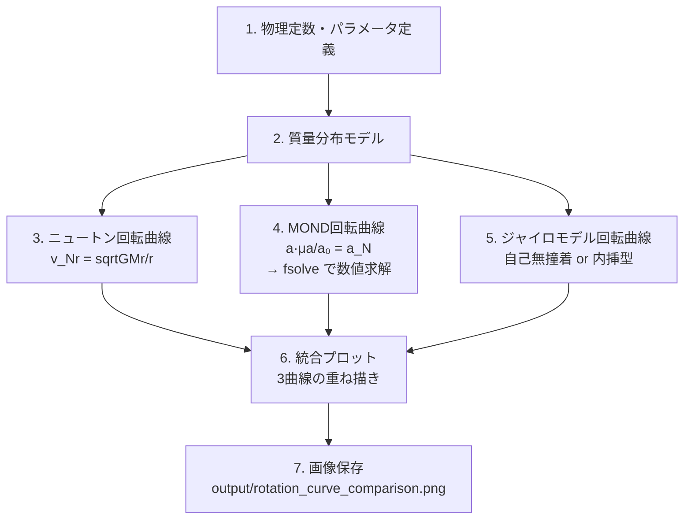

# 全宇宙回転ジェネレーション仮説 — Python 実装計画書

> **Universal Rotation Generation Hypothesis — Python Implementation Plan**
>
> この文書は、[`mathematical_model.md`](mathematical_model.md) で定義した数式モデルを Python で実装するための設計指針を記述する。

---

## 1. プロジェクト構成 / Project Structure

```
gyro_gravity_theory/
├── docs/
│   ├── mathematical_model.md      # 数式モデル設計書
│   └── implementation_plan.md     # 本ファイル（実装計画）
├── config/
│   └── params.yaml                # シミュレーションパラメータ（YAML）
├── src/
│   └── rotation_curve.py          # メインスクリプト（1ファイル完結）
├── output/
│   └── rotation_curve_comparison.png  # 生成画像
├── tests/
│   └── test_rotation_curve.py     # 単体テスト
├── data/
│   └── [観測データファイル]          # 比較用データ（必要に応じて）
├── requirements.txt               # 依存関係
└── README.md                      # プロジェクト概要
```

### ディレクトリ作成コマンド

```bash
mkdir -p gyro_gravity_theory/{docs,config,src,output,tests,data}
```

---

## 2. スクリプト構成 / Script Architecture

### 2.1 全体構成

[`src/rotation_curve.py`](../src/rotation_curve.py) は1ファイル完結型のスクリプト。以下のセクションから構成される:



### 2.2 関数一覧（シグネチャ＋責務）

#### 物理定数モジュール

```python
# --- Physical Constants ---
G = 6.67430e-11           # m^3 kg^-1 s^-2
HBAR = 1.054571817e-34    # J·s
C = 299792458.0           # m/s
H0 = 67.4                 # km/s/Mpc (Planck 2018)
M_SUN = 1.98847e30        # kg
M_P = 1.67262192369e-27   # kg
PC = 3.085677581e16       # m/pc
KPC = PC * 1000           # m/kpc
A0_MOND = 1.2e-10         # m/s^2 (Milgrom's a0)
A0_STAR = C * (H0 * 1000 / KPC) / (2 * np.pi)  # ~1.05e-10 m/s^2
```

> **重要**: [`mathematical_model.md`](mathematical_model.md#65-物理定数--physical-constants) の定数値をそのまま移植。単位変換に注意すること（kpc → m, km/s → m/s）。

#### 質量分布関数

```python
def mass_plummer(r: np.ndarray, M_total: float, a: float) -> np.ndarray:
    """
    Plummer球の累積質量分布。
    M(r) = M_total * r^3 / (r^2 + a^2)^(3/2)
    
    Parameters
    ----------
    r : np.ndarray
        動径距離配列 [kpc]
    M_total : float
        全質量 [M_sun]
    a : float
        Plummer スケール半径 [kpc]
    
    Returns
    -------
    np.ndarray
        各rにおける累積質量 [M_sun]（戻り値はM_sun単位で保持）
    """
```

```python
def mass_exponential_disk(r: np.ndarray, M_disk: float, R_d: float) -> np.ndarray:
    """
    指数関数的減衰円盤の累積質量分布。
    M(r) = M_disk * [1 - (1 + r/R_d) * exp(-r/R_d)]
    
    Parameters
    ----------
    r : np.ndarray
        動径距離配列 [kpc]
    M_disk : float
        円盤質量 [M_sun]
    R_d : float
        スケール長 [kpc]
    
    Returns
    -------
    np.ndarray
        各rにおける累積質量 [M_sun]
    """
```

```python
def mass_bulge_plus_disk(r: np.ndarray, M_bulge: float, a_bulge: float,
                          M_disk: float, R_d: float) -> np.ndarray:
    """
    バルジ（Plummer）＋円盤（指数）の合成質量分布。
    
    Parameters
    ----------
    r : np.ndarray
        動径距離配列 [kpc]
    M_bulge : float
        バルジ質量 [M_sun]
    a_bulge : float
        バルジスケール半径 [kpc]
    M_disk : float
        円盤質量 [M_sun]
    R_d : float
        円盤スケール長 [kpc]
    
    Returns
    -------
    np.ndarray
        各rにおける累積質量 [M_sun]
    """
    return mass_plummer(r, M_bulge, a_bulge) + mass_exponential_disk(r, M_disk, R_d)
```

#### 回転曲線計算関数

```python
def v_newton(r_kpc: np.ndarray, M_kpc: np.ndarray) -> np.ndarray:
    """
    ニュートン力学（ケプラー回転）による軌道速度。
    v(r) = sqrt(G * M(r) / r)
    
    Parameters
    ----------
    r_kpc : np.ndarray
        動径距離 [kpc]
    M_kpc : np.ndarray
        各距離での累積質量 [M_sun]
    
    Returns
    -------
    np.ndarray
        軌道速度 [km/s]
    
    Notes
    -----
    内部で単位変換（kpc → m, M_sun → kg）を実施する。
    """
    r_m = r_kpc * KPC
    M_kg = M_kpc * M_SUN
    v_ms = np.sqrt(G * M_kg / r_m)
    return v_ms / 1000.0  # m/s → km/s
```

```python
def v_mond(r_kpc: np.ndarray, M_kpc: np.ndarray, a0: float = A0_MOND,
           mu_type: str = 'simple') -> np.ndarray:
    """
    MOND理論による軌道速度。
    a · μ(a/a₀) = a_N を fsolve で数値求解し、v = sqrt(a * r) から速度を計算。
    
    Parameters
    ----------
    r_kpc : np.ndarray
        動径距離 [kpc]
    M_kpc : np.ndarray
        各距離での累積質量 [M_sun]
    a0 : float
        MOND限界加速度 [m/s^2]。デフォルト: 1.2e-10
    mu_type : str
        内挿関数の種類 ('simple', 'standard', 'exponential')
    
    Returns
    -------
    np.ndarray
        軌道速度 [km/s]
    
    Notes
    -----
    各半径点で独立に fsolve を実行するため、配列の各要素に対してループ処理。
    深-MOND領域では解析的に v^4 = G M a₀ が成り立つことを確認すること。
    """
```

```python
def v_gyro_model(r_kpc: np.ndarray, M_kpc: np.ndarray,
                 a0_star: float = A0_STAR,
                 model_type: str = 'additive',
                 mu_type: str = 'simple') -> np.ndarray:
    """
    全宇宙回転ジェネレーションモデル（ジャイロモデル）による軌道速度。
    
    Parameters
    ----------
    r_kpc : np.ndarray
        動径距離 [kpc]
    M_kpc : np.ndarray
        各距離での累積質量 [M_sun]
    a0_star : float
        ジャイロモデルの特性加速度 [m/s^2]
    model_type : str
        モデル種別 ('additive': 加算型, 'interpolating': 内挿型)
    mu_type : str
        内挿関数の種類（interpolating モデルのみ使用）
    
    Returns
    -------
    np.ndarray
        軌道速度 [km/s]
    
    Notes
    -----
    - 加算型: a = a_N + a_gyro。自己無撞着に解くため反復法を使用。
    - 内挿型: MOND と数学的同型。a0_star を特性加速度として fsolve 求解。
    """
```

#### 内挿関数

```python
def mu_function(x: np.ndarray, mu_type: str = 'simple') -> np.ndarray:
    """
    MOND/ジャイロモデルの内挿関数 μ(x)。
    
    Parameters
    ----------
    x : np.ndarray
        a/a₀（加速度比）
    mu_type : str
        関数の種類:
        - 'simple':    μ(x) = x / (1 + x)
        - 'standard':  μ(x) = x / sqrt(1 + x²)
        - 'exponential': μ(x) = 1 - exp(-x)
    
    Returns
    -------
    np.ndarray
        μ(x) の値
    """
```

#### プロット関数

```python
def setup_matplotlib_japanese() -> None:
    """
    日本語フォントの設定。
    
    Notes
    -----
    - Linux: Noto Sans CJK JP または IPAexGothic を利用
    - macOS: Hiragino Sans を利用
    - Windows: MS Gothic または Yu Gothic を利用
    - フォントが見つからない場合はフォールバックして英字のみで表示
    """
```

```python
def plot_rotation_curves(
    r: np.ndarray,
    v_newton: np.ndarray,
    v_mond: np.ndarray,
    v_gyro: np.ndarray,
    save_path: str = '../output/rotation_curve_comparison.png',
    galaxy_name: str = 'M33',
    v_obs: Optional[Tuple[np.ndarray, np.ndarray, np.ndarray]] = None
) -> None:
    """
    3つの回転曲線を重ね描きし、画像として保存。
    
    Parameters
    ----------
    r : np.ndarray
        動径距離配列 [kpc]
    v_newton : np.ndarray
        ニュートン力学の速度 [km/s]
    v_mond : np.ndarray
        MOND理論の速度 [km/s]
    v_gyro : np.ndarray
        ジャイロモデルの速度 [km/s]
    save_path : str
        画像の保存先パス
    galaxy_name : str
        銀河名（タイトル表示用）
    v_obs : Optional[Tuple[np.ndarray, np.ndarray, np.ndarray]]
        観測データ (r_obs, v_obs, v_err) — 誤差バー付きでプロット
    
    Graph Specifications
    --------------------
    - X-axis: 銀河中心からの距離 r [kpc] (範囲 1–30 kpc)
    - Y-axis: 星の軌道速度 v [km/s]
    - 凡例（日本語・英語併記）
    - グリッドあり
    - タイトル（日本語・英語併記）
    - 解像度: 300 dpi
    - 保存形式: PNG
    """
```

### 2.3 メイン実行フロー

```python
def main():
    """メイン実行関数。全計算とプロットを実行。"""
    # 1. パラメータ読み込み（YAML or デフォルト値）
    params = load_params()
    
    # 2. 動径グリッド生成
    r = np.linspace(params['r_min'], params['r_max'], params['n_r'])
    
    # 3. 質量分布計算
    M_r = mass_bulge_plus_disk(r, **params['mass_params'])
    
    # 4. 各モデルの回転曲線
    v_N = v_newton(r, M_r)
    v_M = v_mond(r, M_r, a0=params['a0'], mu_type=params['mu_type'])
    v_G = v_gyro_model(r, M_r, a0_star=params['a0_star'],
                       model_type=params['model_type'], mu_type=params['mu_type'])
    
    # 5. 観測データ（オプション）
    obs_data = load_observation_data(params.get('obs_data_file'))
    
    # 6. プロット
    plot_rotation_curves(r, v_N, v_M, v_G, save_path=params['output_path'],
                         galaxy_name=params['galaxy_name'], v_obs=obs_data)
    
    print(f"[✓] 回転曲線比較図を保存しました: {params['output_path']}")

if __name__ == '__main__':
    main()
```

---

## 3. 計算パイプライン詳細 / Computation Pipeline Details

### 3.1 自己無撞着求解（加算型モデル）

加算型モデル $a(r) = a_N(r) + a_{\text{gyro}}(r)$ では、$a_{\text{gyro}}(r)$ が $v(r)$ に依存するため、各半径 $r$ で以下の方程式を解く必要がある:

$$
\frac{v^2}{r} = \frac{G M(r)}{r^2} + \frac{S_{\text{eff}}}{m} \cdot \frac{v}{r^2}
$$

両辺に $r$ を掛けて整理:

$$
v^2 - \frac{S_{\text{eff}}}{m r} v - \frac{G M(r)}{r} = 0
$$

これは $v$ に関する2次方程式:

$$
v = \frac{1}{2} \left[ \frac{S_{\text{eff}}}{m r} + \sqrt{\left(\frac{S_{\text{eff}}}{m r}\right)^2 + \frac{4 G M(r)}{r}} \right]
$$

**実装**:

```python
def v_gyro_additive(r_kpc, M_kpc, S_eff_over_m):
    """
    加算型ジャイロモデルの解析解。
    v = [S_eff/(mr) + sqrt((S_eff/(mr))^2 + 4GM/r)] / 2
    
    ここで S_eff_over_m = S_eff / m は実効スピン密度パラメータ。
    """
    r_m = r_kpc * KPC
    M_kg = M_kpc * M_SUN
    term = S_eff_over_m / r_m
    v_ms = 0.5 * (term + np.sqrt(term**2 + 4 * G * M_kg / r_m))
    return v_ms / 1000.0
```

### 3.2 scipy.optimize.fsolve を用いた数値求解（内挿型）

内挿型モデルでは各半径点で以下の非線形方程式を解く:

$$
F(a) = a \cdot \mu\left(\frac{a}{a_0^*}\right) - a_N = 0
$$

```python
def _mond_equation(a, a_N, a0, mu_type):
    """MOND/ジャイロ内挿方程式の残差。fsolveでゼロ点を探索。"""
    return a * mu_function(a / a0, mu_type) - a_N

# 各半径点で求解
a_N = G * M_kg / r_m**2
a_solutions = np.zeros_like(r_kpc)
for i in range(len(r_kpc)):
    a_solutions[i] = fsolve(
        _mond_equation, x0=a_N[i],  # 初期値はニュートン加速度
        args=(a_N[i], a0_star, mu_type)
    )[0]
v_ms = np.sqrt(a_solutions * r_m)
```

### 3.3 計算精度要件

| 項目 | 要件 | 理由 |
|------|------|------|
| 動径グリッド点数 | $n_r \geq 300$ | 滑らかな曲線描画のため |
| fsolve 許容誤差 | $\text{xtol} = 10^{-12}$ | 高精度なMOND解 |
| 単位変換 | 倍精度 (float64) | 桁落ち防止（ℏ は $10^{-34}$ オーダー） |
| プロット解像度 | 300 dpi | Zenn掲載に十分な品質 |

---

## 4. 観測データとの比較 / Comparison with Observation Data

### 4.1 データソース

1. **SPARC データベース** (Lelli, McGaugh & Schombert 2016):
   - 175の円盤銀河の回転曲線データ
   - 公開URL: http://astroweb.cwru.edu/SPARC/
   - M33 のデータは SPARC に収録

2. **代替**: 論文から数値読み取り（WebPlotDigitizer 等を使用）

### 4.2 データ形式

CSV形式で [`data/`](../data/) に保存:

```csv
# M33 rotation curve data (SPARC)
# r_kpc, v_obs_kms, v_err_kms
0.5, 30.0, 5.0
1.0, 55.0, 4.0
2.0, 85.0, 3.0
3.0, 100.0, 3.0
5.0, 110.0, 3.0
10.0, 120.0, 4.0
15.0, 118.0, 5.0
20.0, 115.0, 6.0
25.0, 112.0, 7.0
```

---

## 5. プロット仕様詳細 / Plot Specifications

### 5.1 グラフデザイン

```
                       回転曲線比較 (Rotation Curve Comparison)
                             銀河: M33 (Galaxy: M33)
  v [km/s]
    250 ─┬─────────────────────────────────────────────────────────
         │                                                   
    200 ─┤                                           
         │                          ╱╱╱╱╱╱╱╱                   
    150 ─┤               ╱╱╱╱╱╱╱╱╱╱╱╱╱╱╱╱╱╱╱╱              
         │          ╱╱╱╱╱╱╱                              ╱╱╱╱╱
    100 ─┤     ╱╱╱╱╱╱╱                                    ╱╱╱
         │  ╱╱╱╱╱                                          ╱╱
     50 ─┤╱╱╱                                              ╱
         │                                              ╱╱
      0 ─┼───┬───┬───┬───┬───┬───┬───┬───┬───┬───┬───┬───
         0   5   10  15  20  25  30
                           r [kpc]
         ─── ニュートン (Newton)
         ─── MOND
         ─── ジャイロモデル (Gyro Model)
         ●  観測データ (Observed, M33 HI)
```

### 5.2 線種・色仕様

| 曲線 | 色 | 線種 | ラベル（日本語） | ラベル（英語） |
|------|-----|------|----------------|---------------|
| ニュートン | 青 `#1f77b4` | 破線 `--` | ニュートン力学 | Newton |
| MOND | 緑 `#2ca02c` | 一点鎖線 `-.` | MOND理論 | MOND |
| ジャイロモデル | 赤 `#d62728` | 実線 `-` | ジャイロモデル | Gyro Model |
| 観測データ | 黒 `#000000` | 散布図 `o` | 観測データ | Observed data |

### 5.3 ファイル保存仕様

```python
plt.savefig(
    save_path,
    dpi=300,
    bbox_inches='tight',
    facecolor='white',
    edgecolor='none'
)
```

---

## 6. パラメータファイル / Parameter File

[`config/params.yaml`](../config/params.yaml) に YAML 形式で保存:

```yaml
# gyro_gravity_theory/config/params.yaml
# 全宇宙回転ジェネレーション仮説 シミュレーションパラメータ

constants:
  G: 6.67430e-11
  hbar: 1.054571817e-34
  c: 299792458.0
  H0: 67.4
  M_sun: 1.98847e30
  m_p: 1.67262192369e-27
  kpc: 3.085677581e19

galaxy:
  name: "M33"
  M_bulge: 0.5e9           # [M_sun] バルジ質量
  a_bulge: 0.3             # [kpc] バルジスケール半径
  M_disk: 9.5e9            # [M_sun] 円盤質量
  R_d: 1.7                 # [kpc] 円盤スケール長
  total_mass: 5.0e10       # [M_sun] 動的全質量（参考値）

simulation:
  r_min: 1.0               # [kpc]
  r_max: 30.0              # [kpc]
  n_r: 300                 # グリッド点数

model:
  type: "interpolating"    # "additive" または "interpolating"
  a0: 1.2e-10              # [m/s^2] MOND限界加速度
  a0_star: null            # [m/s^2] null の場合は c*H0/(2π) で自動計算
  mu_function: "simple"    # "simple", "standard", "exponential"
  S_eff_over_m: null       # [m^2/s] 加算型のみ使用。null→自動計算

output:
  save_path: "../output/rotation_curve_comparison.png"
  dpi: 300
  show_plot: true          # 画面表示も行うか
```

---

## 7. テスト計画 / Testing Strategy

### 7.1 単体テスト（[`tests/test_rotation_curve.py`](../tests/test_rotation_curve.py)）

| テスト項目 | 内容 | 期待される結果 |
|-----------|------|--------------|
| `test_mass_plummer_total` | Plummer球の全質量 | $r \to \infty$ で $M_\text{total}$ に収束 |
| `test_mass_plummer_half` | 半質量半径 | $r = a$ で $M_\text{total}/2$（厳密解） |
| `test_mass_exponential_total` | 指数円盤の全質量 | $r \to \infty$ で $M_\text{disk}$ に収束 |
| `test_v_newton_point_mass` | 点質量のケプラー速度 | $v = \sqrt{GM/r}$ と一致 |
| `test_v_mond_deep_mond` | 深-MOND領域 | $v^4 = G M a_0$ と一致（誤差 1% 以内） |
| `test_v_mond_newton_limit` | ニュートン極限 | $a_N \gg a_0$ で $v \approx v_N$（誤差 1% 以内） |
| `test_v_gyro_additive_analytic` | 加算型の解析解 | 2次方程式の解と一致 |
| `test_v_gyro_interpolating_mond` | 内挿型のMOND一致 | $a_0^* = a_0$ で MOND と完全一致 |
| `test_unit_conversion` | 単位変換の整合性 | Mpc↔m, M_sun↔kg の変換が可逆 |

### 7.2 検証テスト

```python
def test_tully_fisher_relation():
    """
    Tully-Fisher 関係の検証: 深-MOND領域で v^4 ∝ M。
    異なる質量の銀河で計算し、log v と log M の傾きが 0.25 であることを確認。
    """
    masses = np.logspace(9, 12, 10)  # 10^9 to 10^12 M_sun
    velocities = []
    for M in masses:
        r = 20.0  # kpc (外縁部)
        M_enclosed = M  # 単純化: 全質量として
        v = v_mond(np.array([r]), np.array([M_enclosed]), a0=A0_MOND)
        velocities.append(v[0])
    
    slope, intercept = np.polyfit(np.log10(masses), np.log10(velocities), 1)
    assert abs(slope - 0.25) < 0.01, f"Tully-Fisher slope = {slope}, expected 0.25"
```

### 7.3 実行方法

```bash
# プロジェクトルートで
cd gyro_gravity_theory

# メインスクリプト実行
python src/rotation_curve.py

# テスト実行
python -m pytest tests/ -v

# カバレッジ（オプション）
python -m pytest tests/ --cov=src --cov-report=term-missing
```

---

## 8. requirements.txt

```
numpy>=1.21.0
scipy>=1.7.0
matplotlib>=3.4.0
pyyaml>=5.4.0
pytest>=6.2.0
pytest-cov>=2.12.0
```

---

## 9. 実装における注意点 / Implementation Notes

### 9.1 数値安定性

1. **単位変換の統一**: すべての関数は kpc と M_sun で入力を受け付け、内部で SI 単位に変換する。出力は km/s。
2. **ゼロ割防止**: $r=0$ の点は計算範囲から除外する（$r_{\min} = 0.1$ kpc 以上を推奨）。
3. **fsolve の初期値**: MOND方程式の求解では初期値を $a_N$ に設定。深-MOND領域では収束が遅い場合があるため、反復回数を増やすか、解析的近似式で初期化する。

### 9.2 日本語フォント対応

```python
def setup_matplotlib_japanese():
    """日本語フォント設定"""
    import matplotlib.pyplot as plt
    from matplotlib import rcParams
    import os
    
    # 優先フォントリスト
    font_candidates = [
        'Noto Sans CJK JP',
        'IPAexGothic',
        'Hiragino Sans',
        'Yu Gothic',
        'MS Gothic',
    ]
    
    available = {f.name for f in plt.matplotlib.font_manager.fontManager.ttflist}
    for font in font_candidates:
        if font in available:
            rcParams['font.family'] = font
            rcParams['axes.unicode_minus'] = False
            return
    
    # フォールバック: 英字のみ
    print("[!] 日本語フォントが見つかりません。英字で表示します。")
```

### 9.3 観測データがない場合のフォールバック

観測データファイルが存在しない場合、または読み込みに失敗した場合は、観測データなしで3曲線のみをプロットする。エラーは表示せず、警告メッセージを出力するにとどめる。

### 9.4 コードスタイル

- インデント: 4スペース（PEP 8準拠）
- 型ヒント: 全関数に付与
- ドキュメンテーション: NumPy Docstring形式
- Lint: `flake8` または `ruff` でチェック
- フォーマッター: `black` で自動整形

---

## 10. 拡張可能性 / Extensibility

### 将来の拡張機能

| 機能 | 説明 | 優先度 |
|------|------|--------|
| 複数銀河の一括比較 | 異なる銀河パラメータで自動計算 | 中 |
| パラメータフィッティング | 観測データに合わせて $S_{\text{eff}}$ を最適化 | 高 |
| アニメーション表示 | パラメータ掃引による曲線変化の可視化 | 低 |
| 重力レンズ計算 | ジャイロモデルでの重力レンズ効果予測 | 低 |
| 銀河形成シミュレーション連携 | 動的シミュレーションとの統合 | 低 |

---

> **文書バージョン**: v1.0
> **作成日**: 2026-05-07
> **編集可能ファイル**: [`gyro_gravity_theory/docs/implementation_plan.md`](gyro_gravity_theory/docs/implementation_plan.md)
